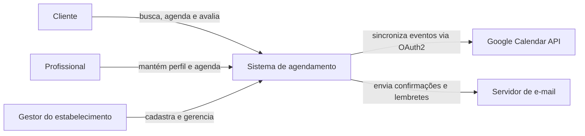
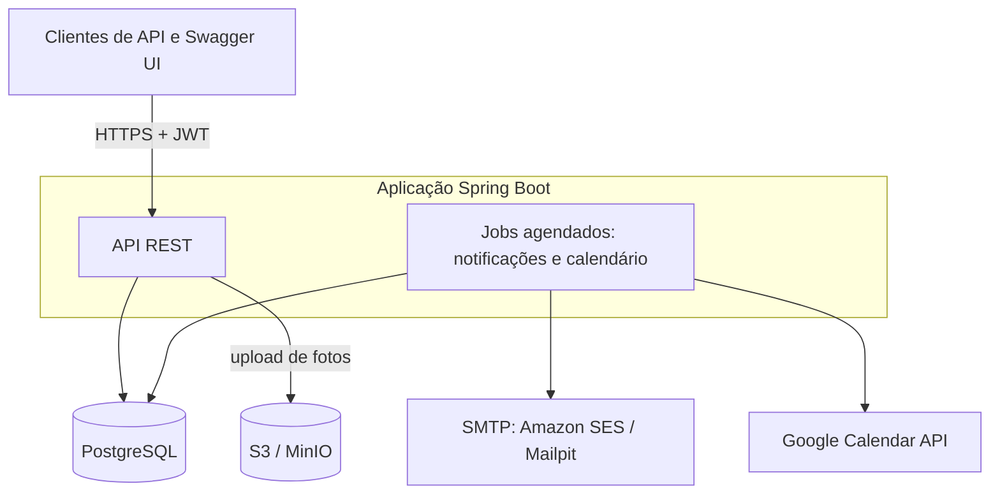
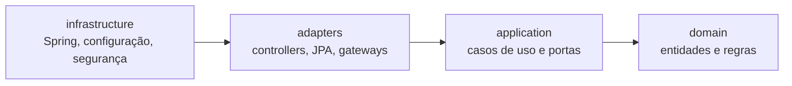
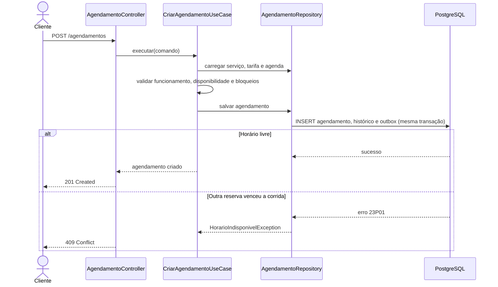
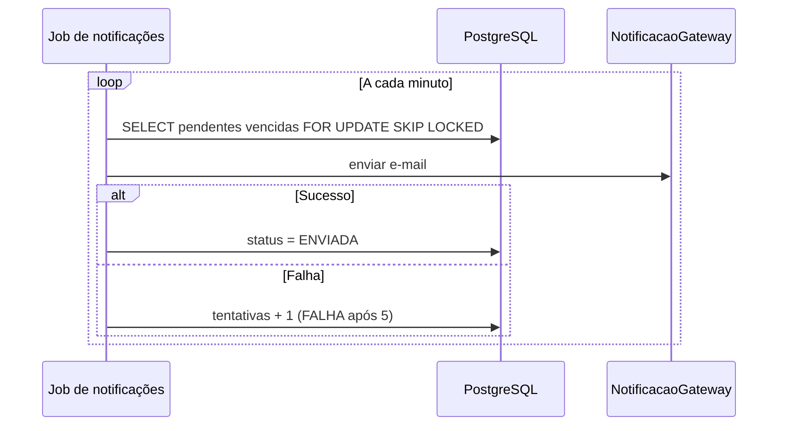
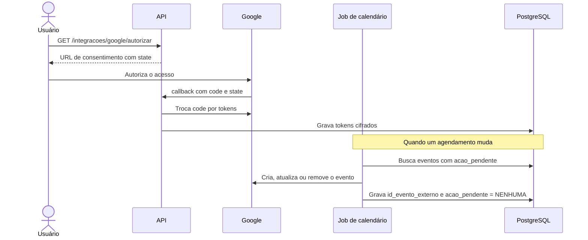
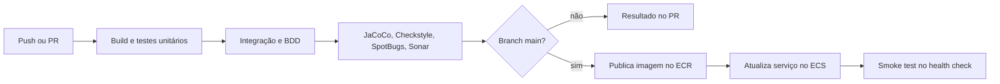
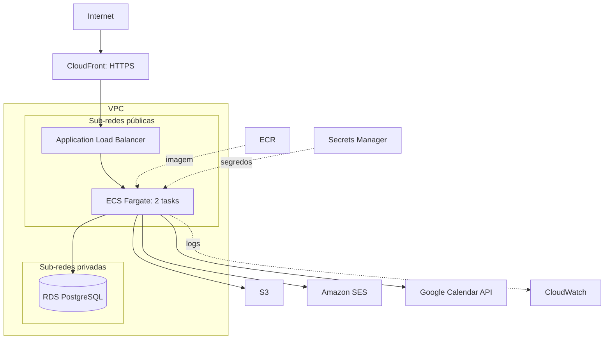

# Arquitetura do Sistema

Sistema de agendamento e gerenciamento de serviços de beleza e bem-estar (Tech Challenge Java, Fase 3, Substitutiva).

Documentos relacionados: [Modelagem de Dados](modelagem-de-dados.md) · [Planejamento de Desenvolvimento](planejamento-de-desenvolvimento.md)

## 1. Visão geral

O sistema é uma API REST em um **monolito modular com Clean Architecture**. O enunciado avalia o backend, portanto não há frontend nesse escopo: o painel do estabelecimento é entregue como endpoints documentados no Swagger.

| Atributo | Como é atendido |
|---|---|
| Regras isoladas de framework | `domain` e `application` sem Spring ou JPA, verificado com ArchUnit |
| Reservas simultâneas sem conflito | Restrição de exclusão no PostgreSQL |
| Notificações confiáveis | Outbox gravada na transação do agendamento |
| Falhas externas não bloqueiam a reserva | Google Calendar e e-mail processados por jobs, com novas tentativas |
| Escala horizontal | API sem estado (JWT), várias tasks no ECS, jobs protegidos com `SKIP LOCKED` |

## 2. Diagrama de contexto



## 3. Diagrama de contêineres



## 4. Clean Architecture

### 4.1 Camadas



As dependências sempre apontam para dentro.

| Camada | Conceito do enunciado | Responsabilidade | Exemplos |
|---|---|---|---|
| `domain` | Entidades | Regras de negócio puras | `Agendamento`, `StatusAgendamento`, `AgendaProfissional`, `Avaliacao` |
| `application` | Casos de uso | Orquestrar um fluxo e declarar portas | `CriarAgendamentoUseCase`, `AgendamentoRepository` (porta) |
| `adapters` | Adaptadores | Traduzir HTTP, banco e APIs externas | `AgendamentoController`, `AgendamentoJpaAdapter`, `GoogleCalendarGateway` |
| `infrastructure` | Frameworks externos | Montar a aplicação | `BeanConfig`, `SecurityConfig`, `@Scheduled` |

### 4.2 Regras verificadas com ArchUnit

- `domain` não depende de `application`, `adapters` ou `infrastructure`.
- `application` depende somente de `domain` e da biblioteca padrão do Java.
- `domain` e `application` não importam `org.springframework..`, `jakarta.persistence..` ou `com.google.api..`.
- Um módulo só acessa outro pelos contratos de `application` ou por eventos, nunca por `adapters` ou tabelas JPA alheias.
- Controllers não acessam repositórios diretamente.

### 4.3 Módulos

| Módulo | Responsabilidade | Funcionalidade do enunciado |
|---|---|---|
| `identidade` | Cadastro, login e papéis | Base para todas |
| `estabelecimentos` | Dados, fotos, horários e serviços | 1 |
| `profissionais` | Perfil, especialidades, tarifas, disponibilidade e bloqueios | 2 |
| `agendamentos` | Horários livres, reserva, status e painel | 3, 6 |
| `avaliacoes` | Avaliações e notas agregadas | 4 |
| `busca` | Consulta com filtros combinados | 5 |
| `notificacoes` | Outbox, confirmações e lembretes | 3b |
| `calendario` | OAuth2 e sincronização | 7 |
| `compartilhado` | Exceções base, eventos e tipos comuns | Apoio |

### 4.4 Estrutura de pacotes

Projeto Maven de módulo único. As fronteiras são garantidas por pacotes e ArchUnit, sem o custo de um build multimódulo.

```text
src/main/java/br/com/fiap/agendabeleza/
├── AgendaBelezaApplication.java
├── agendamentos/
│   ├── domain/
│   │   ├── Agendamento.java
│   │   ├── StatusAgendamento.java
│   │   ├── AgendaProfissional.java
│   │   └── HorarioIndisponivelException.java
│   ├── application/
│   │   ├── usecase/
│   │   │   ├── CriarAgendamentoUseCase.java
│   │   │   ├── ReagendarAgendamentoUseCase.java
│   │   │   └── ConsultarHorariosLivresUseCase.java
│   │   └── port/
│   │       └── AgendamentoRepository.java
│   ├── adapters/
│   │   ├── in/web/
│   │   │   ├── AgendamentoController.java
│   │   │   └── dto/
│   │   └── out/persistence/
│   │       ├── AgendamentoJpaEntity.java
│   │       ├── AgendamentoJpaRepository.java
│   │       └── AgendamentoJpaAdapter.java
│   └── infrastructure/
│       └── AgendamentosConfig.java
├── estabelecimentos/   (mesma estrutura)
├── profissionais/      (mesma estrutura)
├── identidade/         (mesma estrutura)
├── avaliacoes/         (mesma estrutura)
├── busca/              (mesma estrutura)
├── notificacoes/       (mesma estrutura)
├── calendario/         (mesma estrutura)
└── compartilhado/
```

### 4.5 Decisões de implementação

- **Entidade de domínio x entidade JPA:** são classes separadas, convertidas no adaptador. Há mais código, mas o domínio fica independente e testável sem banco.
- **Casos de uso sem Spring:** são classes Java comuns, registradas como beans em `infrastructure`.
- **Transações:** a porta `GerenciadorTransacao` isola o Spring, e sua implementação usa `TransactionTemplate`. Assim, `application` não precisa de `@Transactional`.
- **Eventos entre módulos:** a porta `PublicadorEventos` usa o `ApplicationEventPublisher` do Spring. O ouvinte de notificações roda de forma síncrona, na mesma transação, para gravar a outbox.

## 5. API REST

Prefixo `/api/v1`. A documentação é gerada pelo springdoc em `/swagger-ui.html`. Os erros seguem o formato `application/problem+json` (RFC 9457).

### 5.1 Autenticação e calendário

| Método | Rota | Acesso | Descrição |
|---|---|---|---|
| POST | `/auth/registro` | Público | Cria usuário |
| POST | `/auth/login` | Público | Retorna JWT |
| GET | `/integracoes/google/autorizar` | Autenticado | Retorna a URL de consentimento do Google |
| GET | `/integracoes/google/callback` | Público, valida `state` | Conclui o OAuth2 |
| GET | `/integracoes/google` | Autenticado | Consulta o status da integração |
| DELETE | `/integracoes/google` | Autenticado | Revoga a integração |

### 5.2 Estabelecimentos e profissionais

| Método | Rota | Acesso | Descrição |
|---|---|---|---|
| POST | `/estabelecimentos` | Gestor | Cadastra estabelecimento |
| GET | `/estabelecimentos/{id}` | Público | Consulta detalhes |
| PUT | `/estabelecimentos/{id}` | Gestor dono | Atualiza dados |
| POST | `/estabelecimentos/{id}/fotos` | Gestor dono | Envia foto (multipart) |
| DELETE | `/estabelecimentos/{id}/fotos/{fotoId}` | Gestor dono | Remove foto |
| PUT | `/estabelecimentos/{id}/horarios` | Gestor dono | Define horário de funcionamento |
| POST | `/estabelecimentos/{id}/servicos` | Gestor dono | Cadastra serviço |
| GET | `/estabelecimentos/{id}/servicos` | Público | Lista serviços |
| PUT | `/servicos/{id}` | Gestor dono | Atualiza serviço |
| POST | `/estabelecimentos/{id}/profissionais` | Gestor dono | Cadastra profissional |
| GET | `/estabelecimentos/{id}/profissionais` | Público | Lista profissionais |
| GET | `/profissionais/{id}` | Público | Consulta perfil |
| PUT | `/profissionais/{id}` | Gestor ou próprio | Atualiza perfil |
| PUT | `/profissionais/{id}/especialidades` | Gestor ou próprio | Define especialidades |
| PUT | `/profissionais/{id}/servicos` | Gestor ou próprio | Define serviços e tarifas |
| PUT | `/profissionais/{id}/disponibilidades` | Gestor ou próprio | Define jornada semanal |
| POST | `/profissionais/{id}/bloqueios` | Gestor ou próprio | Cria bloqueio |
| DELETE | `/profissionais/{id}/bloqueios/{bloqueioId}` | Gestor ou próprio | Remove bloqueio |

### 5.3 Agendamentos e painel

| Método | Rota | Acesso | Descrição |
|---|---|---|---|
| GET | `/profissionais/{id}/horarios-livres?servicoId&data` | Público | Lista horários disponíveis |
| POST | `/agendamentos` | Cliente | Cria agendamento. Retorna 409 em caso de conflito |
| GET | `/agendamentos/meus` | Cliente | Lista histórico próprio |
| GET | `/agendamentos/{id}` | Partes envolvidas | Consulta detalhes |
| POST | `/agendamentos/{id}/confirmar` | Gestor ou profissional | Confirma |
| POST | `/agendamentos/{id}/reagendar` | Cliente ou gestor | Altera o horário |
| POST | `/agendamentos/{id}/cancelar` | Cliente ou gestor | Cancela |
| POST | `/agendamentos/{id}/concluir` | Gestor ou profissional | Conclui |
| POST | `/agendamentos/{id}/nao-comparecimento` | Gestor ou profissional | Registra falta |
| GET | `/estabelecimentos/{id}/agendamentos?de&ate&status&profissionalId` | Gestor dono | Painel: agenda filtrada |
| GET | `/estabelecimentos/{id}/painel/resumo?de&ate` | Gestor dono | Painel: totais por status |

### 5.4 Avaliações e busca

| Método | Rota | Acesso | Descrição |
|---|---|---|---|
| POST | `/agendamentos/{id}/avaliacao` | Cliente do agendamento | Avalia atendimento concluído |
| GET | `/estabelecimentos/{id}/avaliacoes` | Público | Lista avaliações |
| GET | `/profissionais/{id}/avaliacoes` | Público | Lista avaliações |
| GET | `/busca/estabelecimentos` | Público | Busca paginada com filtros |

Filtros de `/busca/estabelecimentos`, combináveis entre si:

| Critério | Parâmetros |
|---|---|
| Nome | `nome` |
| Serviço | `servico`, `categoria` |
| Localização | `cidade`, `bairro`, `latitude`, `longitude`, `raioKm` |
| Avaliação | `notaMinima` |
| Faixa de preço | `precoMin`, `precoMax` |
| Disponibilidade | `data`, `horaInicio`, `horaFim` |
| Paginação e ordenação | `page`, `size`, `sort` |

## 6. Fluxos principais

### 6.1 Criar agendamento



### 6.2 Notificações



- Cada reserva gera quatro registros: confirmação e lembrete, para o cliente e para o profissional.
- O envio é "pelo menos uma vez": se a task cair depois de enviar e antes de atualizar o status, o e-mail pode se repetir. Esse risco é aceitável para este domínio.

### 6.3 Sincronização com Google Calendar



Uma falha no Google nunca desfaz a reserva. Se o Google recusar o refresh token, a integração passa para `REVOGADA`.

## 7. Segurança

- **Autenticação:** JWT assinado, com expiração curta. Senhas em BCrypt.
- **Autorização:** papéis no `SecurityConfig` e verificação de posse nos casos de uso, como "o gestor é dono deste estabelecimento".
- **OAuth2:** `state` assinado e com validade, vinculado ao usuário, para evitar CSRF no callback. Escopo mínimo: `https://www.googleapis.com/auth/calendar.events`.
- **Tokens do Google:** cifrados com AES-GCM, com chave guardada fora do banco.
- **Segredos:** variáveis de ambiente no local e Secrets Manager na AWS. Nada é versionado no Git.
- **Entradas:** Bean Validation nos DTOs. Fotos limitadas por tipo e tamanho.

## 8. Tecnologias

| Finalidade | Escolha |
|---|---|
| Linguagem e framework | Java 21, Spring Boot 3 |
| Build | Maven |
| Persistência | Spring Data JPA, PostgreSQL 16, Flyway |
| Segurança | Spring Security, JWT |
| Documentação | springdoc-openapi (Swagger), Javadoc |
| Integração com calendário | Biblioteca cliente da Google Calendar API |
| Contêineres | Docker, Docker Compose |
| CI/CD | GitHub Actions |
| Infraestrutura como código | Terraform |

## 9. Estratégia de qualidade

| Critério da avaliação | Ferramenta | O que cobre | Quando roda |
|---|---|---|---|
| Testes unitários (TDD) | JUnit 5, Mockito, AssertJ | Domínio e casos de uso | Todo push |
| Cobertura | JaCoCo | Mínimo de 80% em `domain` e `application`; abaixo disso o build falha | Todo push |
| Regras de arquitetura | ArchUnit | Regras da seção 4.2 | Todo push |
| Testes integrados | Testcontainers, WireMock | Repositórios, restrição de conflito, jobs, Google simulado | Todo push |
| Controllers e BDD | Cucumber, RestAssured | Cenários em Gherkin, em português, por funcionalidade | Todo push |
| Análise estática | SonarCloud, Checkstyle, SpotBugs | Bugs, code smells, duplicação | Todo push |
| Performance e carga | Gatling | Cenários da seção 9.3 | Manual, via `workflow_dispatch` |

### 9.1 Evidência de TDD

O histórico do Git deve mostrar o ciclo: um commit `test:` falhando, depois `feat:` e, quando houver, `refactor:`. Essa evidência será citada no Relatório Técnico.

### 9.2 Exemplo de cenário BDD

```gherkin
# language: pt
Funcionalidade: Agendamento de serviços

  Cenário: Dois clientes tentam reservar o mesmo horário
    Dado um profissional com horário livre em "2026-12-10T14:00:00-03:00"
    Quando dois clientes solicitam esse horário ao mesmo tempo
    Então um agendamento é criado com status 201
    E a outra solicitação recebe status 409
```

### 9.3 Cenários de carga

As metas abaixo são próprias do projeto, já que o enunciado não define números. Elas podem ser ajustadas após a primeira medição em 23/11.

| Cenário | Carga | Meta |
|---|---|---|
| Busca com filtros | 200 usuários simultâneos por 5 minutos | p95 < 500 ms, erros < 1% |
| Consulta de horários livres | 200 usuários simultâneos por 5 minutos | p95 < 500 ms, erros < 1% |
| Reservas em horários distintos | 100 reservas por segundo durante 2 minutos | p95 < 800 ms, erros < 1% |
| Disputa pelo mesmo horário | 100 requisições simultâneas | Exatamente um 201 e 99 respostas 409 |

## 10. CI/CD



O GitHub Actions acessa a AWS por OIDC, sem chaves de longa duração no repositório.

## 11. Deploy

### 11.1 Ambientes

| Item | Local (`local`) | AWS (`aws`) |
|---|---|---|
| Execução | Docker Compose | ECS Fargate com 2 tasks atrás de um ALB |
| Banco | PostgreSQL em contêiner | RDS PostgreSQL |
| Fotos | MinIO | S3 |
| E-mail | Mailpit | Amazon SES, no modo sandbox com endereços verificados |
| Segredos | Arquivo `.env` fora do Git | Secrets Manager |
| Logs | Console | CloudWatch |
| Endereço para OAuth | `http://localhost:8080` | HTTPS pelo domínio do CloudFront |

### 11.2 Topologia na AWS



- **Tasks em sub-rede pública:** recebem tráfego apenas do security group do ALB. Isso dispensa o NAT Gateway e reduz o custo.
- **CloudFront:** o Google só aceita redirect URI em HTTPS, salvo para `localhost`, e o domínio padrão do ALB não oferece certificado próprio. O CloudFront resolve isso com um domínio HTTPS sem precisar registrar um domínio.
- **Encerramento:** `terraform destroy` remove tudo depois da correção, para evitar custo contínuo.

## 12. Decisões arquiteturais

| # | Decisão | Motivo | Consequência |
|---|---|---|---|
| ADR-01 | Monolito modular em vez de microsserviços | O enunciado não exige distribuição, e o prazo favorece um único deployable | Extrair serviços depois exige trocar eventos internos por mensageria |
| ADR-02 | Evitar conflito com `EXCLUDE` no banco | Garante a regra sob concorrência, sem bloqueios distribuídos | Vínculo com PostgreSQL, compensado por testes com Testcontainers |
| ADR-03 | Outbox em tabela, sem broker | Atomicidade e novas tentativas com menos infraestrutura | Polling a cada minuto, suficiente para e-mails |
| ADR-04 | `FOR UPDATE SKIP LOCKED` nos jobs | Evita processamento duplicado entre tasks | Implementado em SQL nativo no adaptador |
| ADR-05 | Entidades de domínio separadas das JPA | Independência de framework, critério central da avaliação | Mais classes e mapeadores |
| ADR-06 | Busca em SQL com `pg_trgm` em vez de Elasticsearch | Atende ao requisito com menos componentes | Menos recursos de relevância textual |
| ADR-07 | Google por trás de `CalendarioGateway` | Testes com WireMock e espaço para Outlook | Apenas Google será implementado nesta entrega |
| ADR-08 | ECS Fargate em vez de EC2 ou EKS | Citado no enunciado, sem administrar servidores | Tem custo, controlado com alerta de orçamento e `terraform destroy` |

## 13. Requisitos de avaliação x arquitetura

| Item do enunciado | Onde é atendido |
|---|---|
| Clean Architecture | Seção 4 |
| Testes unitários (TDD) | Seções 9 e 9.1 |
| Testes integrados e análise de código | Seção 9 |
| Testes de controllers, CI e BDD | Seções 9.2 e 10 |
| Testes não funcionais | Seção 9.3 |
| Deploy local e em nuvem | Seção 11 |
| Documentação da API | Seção 5, Swagger e Javadoc |
