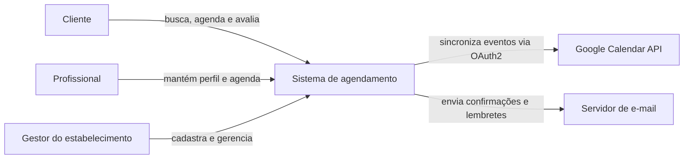
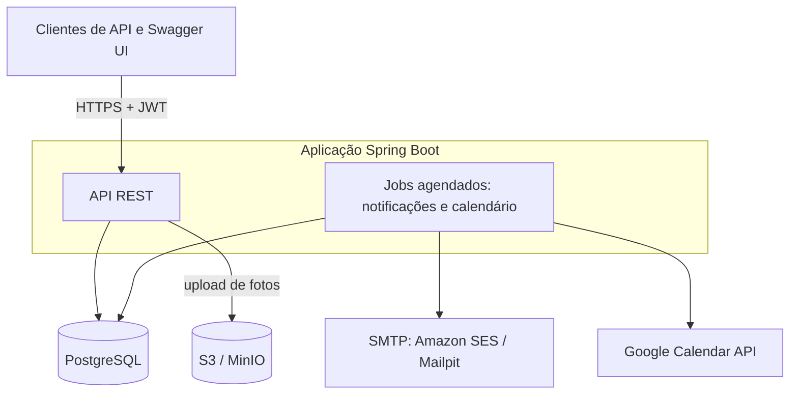
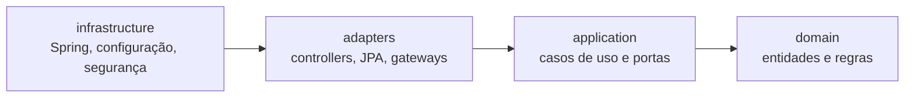
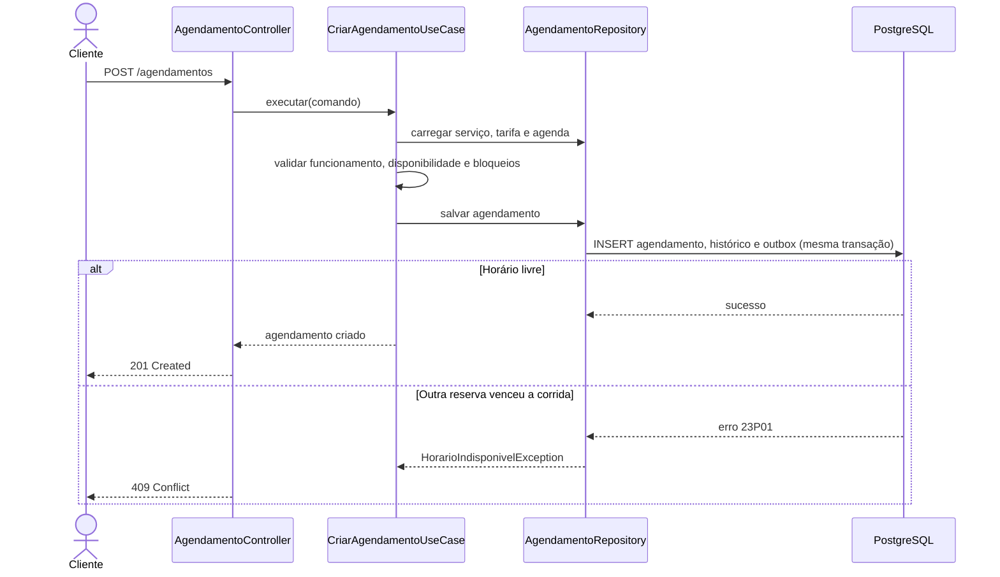
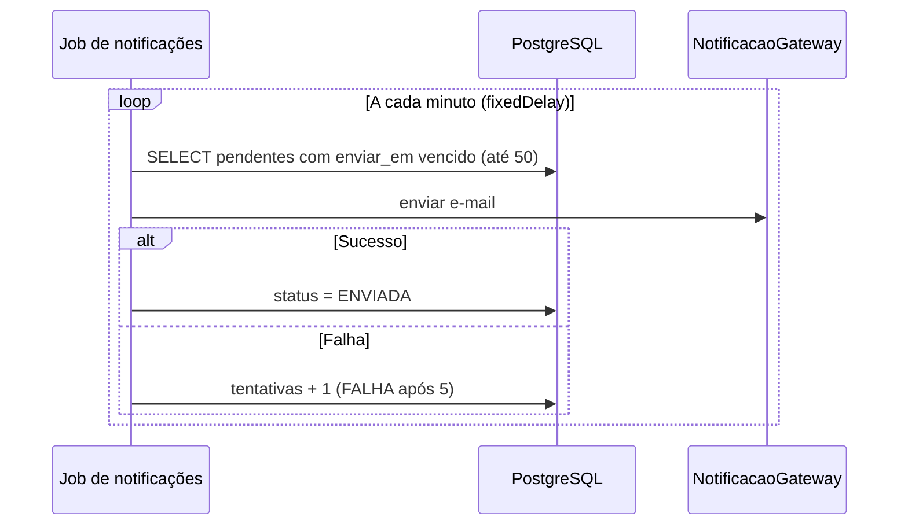
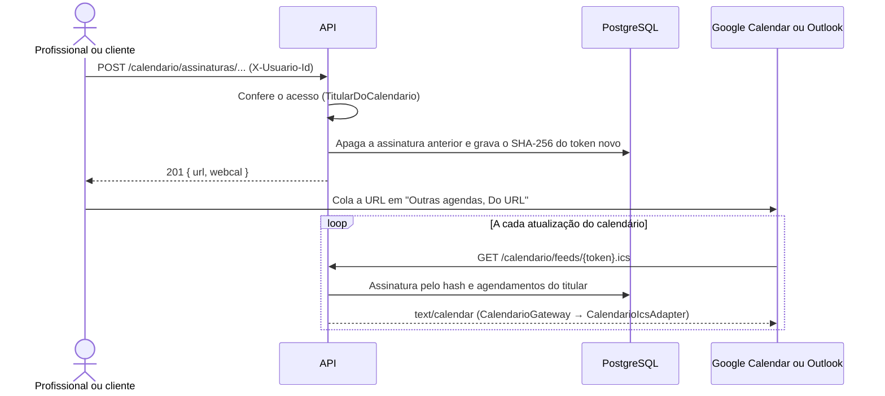
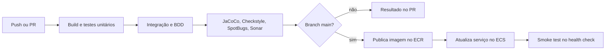
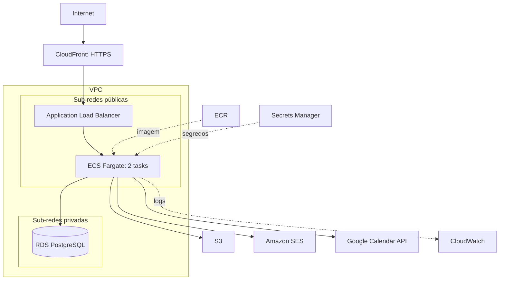

# Arquitetura do Sistema

Sistema de agendamento e gerenciamento de serviços de beleza e bem-estar (Tech Challenge Java, Fase 3, Substitutiva).

Documentos relacionados: [Modelagem de Dados](modelagem-de-dados.md) · [Planejamento de Desenvolvimento](planejamento-de-desenvolvimento.md)

## 1. Visão geral

O sistema é uma API REST em um **monolito modular com Clean Architecture**. O enunciado avalia o backend, portanto não há frontend nesse escopo: o painel do estabelecimento é entregue como endpoints documentados no Swagger.

| Atributo | Como é atendido |
|---|---|
| Regras isoladas de framework | `domain` e `application` sem Spring ou JPA, verificado com ArchUnit |
| Reservas simultâneas sem conflito | Restrição de exclusão no PostgreSQL |
| Notificações confiáveis | Outbox gravada na transação do agendamento |
| Falhas externas não bloqueiam a reserva | Google Calendar e e-mail processados por jobs, com novas tentativas |
| Escala horizontal | API sem estado (JWT), várias tasks no ECS, jobs protegidos com `SKIP LOCKED` |

## 2. Diagrama de contexto



## 3. Diagrama de contêineres



## 4. Clean Architecture

### 4.1 Camadas



As dependências sempre apontam para dentro.

| Camada | Conceito do enunciado | Responsabilidade | Exemplos |
|---|---|---|---|
| `domain` | Entidades | Regras de negócio puras | `Agendamento`, `StatusAgendamento`, `AgendaProfissional`, `Avaliacao` |
| `application` | Casos de uso | Orquestrar um fluxo e declarar portas | `CriarAgendamentoUseCase`, `AgendamentoRepository` (porta) |
| `adapters` | Adaptadores | Traduzir HTTP, banco e APIs externas | `AgendamentoController`, `AgendamentoJpaAdapter`, `GoogleCalendarGateway` |
| `infrastructure` | Frameworks externos | Montar a aplicação | `BeanConfig`, `SecurityConfig`, `@Scheduled` |

### 4.2 Regras verificadas com ArchUnit

As regras ficam em `src/test/java/br/com/fiap/agendabeleza/api/arquitetura/RegrasArquiteturaTest.java` e rodam a cada build.

- As camadas só dependem para dentro: `infrastructure` → `adapters` → `application` → `domain`.
- `domain` depende somente de `domain` e da biblioteca padrão do Java.
- `application` depende somente de `domain` e da biblioteca padrão do Java.
- `domain` e `application` não importam `org.springframework..`, `jakarta.persistence..` ou `com.google.api..`.
- Um módulo só acessa outro pelos contratos de `application` ou por eventos, nunca por `adapters`, `infrastructure` ou tabelas JPA alheias.
- `compartilhado` não depende de nenhum módulo de negócio.
- Controllers não acessam repositórios diretamente.
- Classes `@Entity` ficam somente em `adapters.out.persistence`.

### 4.3 Módulos

| Módulo | Responsabilidade | Funcionalidade do enunciado |
|---|---|---|
| `identidade` | Cadastro, login e papéis | Base para todas |
| `estabelecimentos` | Dados, fotos, horários e serviços | 1 |
| `profissionais` | Perfil, especialidades, tarifas, disponibilidade e bloqueios | 2 |
| `agendamentos` | Horários livres, reserva, status e painel | 3, 6 |
| `avaliacoes` | Avaliações e notas agregadas | 4 |
| `busca` | Consulta com filtros combinados | 5 |
| `notificacoes` | Outbox, confirmações e lembretes | 3b |
| `calendario` | Feed iCalendar (`.ics`) por URL secreta, para profissional e cliente | 7 |
| `compartilhado` | Exceções base, eventos e tipos comuns | Apoio |

### 4.4 Estrutura de pacotes

Projeto Maven de módulo único. As fronteiras são garantidas por pacotes e ArchUnit, sem o custo de um build multimódulo.

```text
src/main/java/br/com/fiap/agendabeleza/api/
├── AgendaBelezaApplication.java
├── agendamentos/
│   ├── domain/
│   │   ├── Agendamento.java
│   │   ├── StatusAgendamento.java
│   │   ├── AgendaProfissional.java
│   │   └── HorarioIndisponivelException.java
│   ├── application/
│   │   ├── usecase/
│   │   │   ├── CriarAgendamentoUseCase.java
│   │   │   ├── AlteracaoDeAgendamentoUseCase.java   (base das ações de gestão)
│   │   │   ├── ReagendarAgendamentoUseCase.java
│   │   │   └── ConsultarHorariosLivresUseCase.java
│   │   └── port/
│   │       └── AgendamentoRepository.java
│   ├── adapters/
│   │   ├── in/web/
│   │   │   ├── AgendamentoController.java
│   │   │   └── dto/
│   │   └── out/persistence/
│   │       ├── AgendamentoJpaEntity.java
│   │       ├── AgendamentoJpaRepository.java
│   │       └── AgendamentoJpaAdapter.java
│   └── infrastructure/
│       └── AgendamentosConfig.java
├── estabelecimentos/   (mesma estrutura)
├── profissionais/      (mesma estrutura)
├── identidade/         (mesma estrutura)
├── avaliacoes/         (mesma estrutura)
├── busca/              (mesma estrutura)
├── notificacoes/       (mesma estrutura)
├── calendario/         (mesma estrutura)
└── compartilhado/
```

### 4.5 Decisões de implementação

- **Entidade de domínio x entidade JPA:** são classes separadas, convertidas no adaptador. Há mais código, mas o domínio fica independente e testável sem banco.
- **Casos de uso sem Spring:** são classes Java comuns, registradas como beans em `infrastructure`.
- **Transações:** a porta `GerenciadorTransacao` isola o Spring, e sua implementação usa `TransactionTemplate`. Assim, `application` não precisa de `@Transactional`.
- **E-mail:** a porta `NotificacaoGateway` (`notificacoes/application/port`) recebe uma `Mensagem` já validada. O `NotificacaoSmtpAdapter` envia por SMTP com o `JavaMailSender` e traduz `MailException` em `FalhaNoEnvioException`, então o núcleo não conhece o Spring. Localmente o servidor é o Mailpit (`spring.mail.host`/`port`).
- **Eventos entre módulos:** a porta `PublicadorEventos` usa o `ApplicationEventPublisher` do Spring. O ouvinte de notificações roda de forma síncrona, na mesma transação, para gravar a outbox.

## 5. API REST

Prefixo `/api/v1`. A documentação é gerada pelo springdoc em `/swagger-ui.html`. Os erros seguem o formato `application/problem+json` (RFC 9457).

### 5.1 Autenticação e calendário

As rotas `/auth/*` (JWT) e `/integracoes/google/*` (OAuth2) saíram do escopo em 20/11 (planejamento, seção 2.1). O usuário chega no cabeçalho `X-Usuario-Id`, e a integração com calendários é um feed iCalendar que o Google Calendar e o Outlook assinam por URL (implementado em 26/11):

| Método | Rota | Acesso | Descrição |
|---|---|---|---|
| POST | `/calendario/assinaturas/profissionais/{profissionalId}` | Gestor do estabelecimento ou o próprio profissional | Gera a URL secreta da agenda do profissional. Responde 201 com `{ url, webcal }` e a mesma URL no `Location`; 400 sem `X-Usuario-Id`, 403 para os demais usuários e 404 para profissional inexistente |
| POST | `/calendario/assinaturas/cliente` | O cliente do `X-Usuario-Id` | Gera a URL secreta dos horários do cliente, em todos os estabelecimentos. Responde 201 com `{ url, webcal }`; 400 sem `X-Usuario-Id` |
| GET | `/calendario/feeds/{token}.ics` | Público (o token é a credencial) | Feed `text/calendar; charset=utf-8`. Responde 404, sem diferenciar, para token malformado, desconhecido ou já trocado |

Cada `POST` gera um token novo e invalida o anterior do mesmo titular: é assim que um link vazado é revogado. O token tem 256 bits aleatórios em Base64 para URL (43 caracteres), e o banco guarda só o SHA-256 dele. O feed traz os agendamentos que terminam a partir de 30 dias atrás, sem limite à frente e sem os cancelados (um evento que some do feed some da agenda assinada). `AGENDADO` sai como `STATUS:TENTATIVE`; confirmado, concluído e não comparecimento, como `CONFIRMED`. Os horários vão em UTC, sem `VTIMEZONE`, e cada calendário os mostra no fuso de quem assina. O `UID` é fixo por agendamento e o `SEQUENCE` é a versão dele, para que um reagendamento troque o evento em vez de duplicá-lo. No feed do profissional, o título é o serviço; no do cliente, "serviço em estabelecimento". A URL é montada a partir do endereço que o cliente usou: atrás de túnel ou da plataforma em nuvem, `server.forward-headers-strategy=framework` faz valer os cabeçalhos `X-Forwarded-*`.

### 5.2 Estabelecimentos e profissionais

| Método | Rota | Acesso | Descrição |
|---|---|---|---|
| POST | `/estabelecimentos` | Gestor | Cadastra estabelecimento |
| GET | `/estabelecimentos/{id}` | Público | Consulta detalhes |
| PUT | `/estabelecimentos/{id}` | Gestor dono | Atualiza dados |
| POST | `/estabelecimentos/{id}/fotos` | Gestor dono | Adiciona foto informada como URL (`{ "url": ... }`) |
| DELETE | `/estabelecimentos/{id}/fotos/{fotoId}` | Gestor dono | Remove foto |
| PUT | `/estabelecimentos/{id}/horarios` | Gestor dono | Define horário de funcionamento |
| POST | `/estabelecimentos/{id}/servicos` | Gestor dono | Cadastra serviço |
| GET | `/estabelecimentos/{id}/servicos` | Público | Lista os serviços ativos |
| PUT | `/estabelecimentos/{id}/servicos/{servicoId}` | Gestor dono | Atualiza, ativa ou desativa serviço |
| POST | `/estabelecimentos/{id}/profissionais` | Gestor dono | Cadastra profissional. Retorna 409 se o `usuarioId` já estiver vinculado a outro profissional |
| GET | `/estabelecimentos/{id}/profissionais` | Público | Lista profissionais ativos, sem e-mail |
| GET | `/especialidades` | Público | Lista o catálogo de especialidades |
| GET | `/profissionais/{id}` | Público | Consulta perfil, com os nomes das especialidades e sem e-mail |
| PUT | `/profissionais/{id}` | Gestor ou próprio | Atualiza perfil |
| PUT | `/profissionais/{id}/especialidades` | Gestor ou próprio | Define especialidades |
| PUT | `/profissionais/{id}/servicos` | Gestor ou próprio | Define serviços e tarifas. Tarifa ausente assume o preço base |
| PUT | `/profissionais/{id}/disponibilidades` | Gestor ou próprio | Define jornada semanal, dentro do funcionamento do estabelecimento |
| POST | `/profissionais/{id}/bloqueios` | Gestor ou próprio | Cria bloqueio `[inicio, fim)`. Retorna 422 se o fim não for posterior ao início ou se o bloqueio já tiver terminado e 409 se houver agendamento ativo no período |
| GET | `/profissionais/{id}/bloqueios` | Gestor ou próprio | Lista os bloqueios que ainda não terminaram, ordenados pelo início |
| DELETE | `/profissionais/{id}/bloqueios/{bloqueioId}` | Gestor ou próprio | Remove bloqueio. Retorna 404 se ele não existir ou for de outro profissional |

Os bloqueios recebem `inicio` e `fim` com fuso (`2026-11-30T10:00:00-03:00`) e são devolvidos em UTC (`2026-11-30T13:00:00Z`).

### 5.3 Agendamentos e painel

| Método | Rota | Acesso | Descrição |
|---|---|---|---|
| GET | `/profissionais/{id}/horarios-livres?servicoId&data` | Público | Lista horários disponíveis, descontando bloqueios e agendamentos ativos. Retorna 404 se o profissional, o serviço ou o estabelecimento não existir e 422 se algum deles estiver inativo, se o serviço for de outro estabelecimento ou se o profissional não o executar |
| POST | `/agendamentos` | Cliente | Cria agendamento com a tarifa do profissional e registra a confirmação por e-mail para o cliente (`emailCliente`, obrigatório) e para o profissional. Retorna 400 para campo ausente ou `emailCliente` inválido, 404 para profissional ou serviço inexistente, 422 para horário no passado, fora do atendimento ou em bloqueio do profissional e 409 para horário ocupado |
| GET | `/agendamentos/meus` | Cliente | Lista histórico próprio, do mais recente para o mais antigo |
| GET | `/agendamentos/{id}` | Partes envolvidas | Consulta detalhes. Cliente, gestor ou profissional; os demais recebem 403 |
| POST | `/agendamentos/{id}/confirmar` | Gestor ou profissional | Confirma um agendamento `AGENDADO`. Retorna 422 para os demais status |
| POST | `/agendamentos/{id}/reagendar` | Cliente ou gestor | Recebe `{ "novoInicio" }` e mantém a duração; o status volta para `AGENDADO`. O novo horário passa pelas regras da reserva, sem contar o horário atual do próprio agendamento: 422 para agendamento inativo, início no passado ou igual ao atual, bloqueio ou fora do atendimento, e 409 para outro agendamento no horário |
| POST | `/agendamentos/{id}/cancelar` | Cliente ou gestor | Cancela um agendamento ativo e libera o horário. Corpo opcional `{ "motivo" }`, de até 250 caracteres, gravado no histórico |
| POST | `/agendamentos/{id}/concluir` | Gestor ou profissional | Conclui um agendamento `CONFIRMADO`, a partir do início. Retorna 422 antes do início ou para os demais status |
| POST | `/agendamentos/{id}/nao-comparecimento` | Gestor ou profissional | Registra a falta em um agendamento `CONFIRMADO`, a partir do início. Retorna 422 antes do início ou para os demais status |

As cinco ações de gestão respondem 200 com o agendamento como ficou gravado, 404 se ele não existir, 403 para quem não tem a permissão indicada, 422 para uma transição fora do diagrama de status (modelagem, seção 4.2) e 409 se outra operação tiver gravado o agendamento antes (bloqueio otimista). Cada uma grava uma linha em `agendamento_historico`.

| Método | Rota | Acesso | Descrição |
|---|---|---|---|
| GET | `/estabelecimentos/{id}/agendamentos?de&ate&status&profissionalId` | Gestor dono | Painel: agendamentos que começam no período, em ordem de início. `status` pode se repetir (`status=AGENDADO&status=CONFIRMADO`); sem ele, todos os status |
| GET | `/estabelecimentos/{id}/painel/resumo?de&ate&profissionalId` | Gestor dono | Painel: total, total por status (os cinco, com zero quando não houver), receita realizada (`CONCLUIDO`) e receita prevista (`AGENDADO` e `CONFIRMADO`) |

As duas rotas do painel ficam no `PainelEstabelecimentoController` do módulo de agendamentos. `de` e `ate` são datas (`aaaa-mm-dd`) no fuso do estabelecimento, e o período inclui os dois dias: vira `[de 00:00, ate+1 00:00)`. Sem datas, vale o dia de hoje; só com uma delas, vale esse dia. Respondem 400 para data, status ou UUID malformado, 403 se o usuário não for o gestor, 404 se o estabelecimento não existir e 422 se `ate` for anterior a `de` ou se o período passar de 31 dias. O resumo reaproveita a consulta da agenda (`ResumirAgendaDoEstabelecimentoUseCase` compõe `ConsultarAgendaDoEstabelecimentoUseCase`), e a parte comum, que carrega o estabelecimento, exige o gestor e resolve o período, fica em `PeriodoDoPainel`. No adaptador, os filtros opcionais são `Specification` combináveis (`AgendamentoEspecificacoes`), apoiados no índice `idx_agendamento_estab_inicio`.

Resposta do resumo:

```json
{
  "de": "2030-03-04",
  "ate": "2030-03-04",
  "fuso": "America/Sao_Paulo",
  "total": 6,
  "porStatus": { "AGENDADO": 2, "CONFIRMADO": 1, "CONCLUIDO": 2, "CANCELADO": 1, "NAO_COMPARECEU": 0 },
  "receitaRealizada": 180.00,
  "receitaPrevista": 120.00
}
```

Resposta de horários livres, com os horários no fuso do estabelecimento e `fim` exclusivo:

```json
{
  "data": "2026-11-30",
  "fuso": "America/Sao_Paulo",
  "duracaoMinutos": 60,
  "horarios": [{ "inicio": "2026-11-30T09:00:00-03:00", "fim": "2026-11-30T10:00:00-03:00" }]
}
```

### 5.4 Avaliações e busca

| Método | Rota | Acesso | Descrição |
|---|---|---|---|
| POST | `/agendamentos/{id}/avaliacao` | Cliente do agendamento | Avalia atendimento concluído com `{ "notaEstabelecimento", "notaProfissional", "comentario"? }`, notas de 1 a 5 e comentário de até 1000 caracteres. Responde 201, 400 para nota ausente ou fora da escala e comentário longo, 404 para agendamento inexistente, 403 para quem não é o cliente e 422 para atendimento não concluído ou já avaliado |
| GET | `/estabelecimentos/{id}/avaliacoes` | Público | Lista avaliações, da mais recente para a mais antiga, sem o `clienteId`. 404 se o estabelecimento não existir |
| GET | `/profissionais/{id}/avaliacoes` | Público | Lista avaliações, da mais recente para a mais antiga, sem o `clienteId`. 404 se o profissional não existir |
| GET | `/busca/estabelecimentos` | Público | Busca paginada de estabelecimentos ativos com filtros combinados. Responde 200 com `{ itens, pagina, tamanho, totalDeItens, totalDePaginas }`; 400 para número, data, hora, categoria ou ordem malformados, página negativa, tamanho fora de 1 a 50, nota mínima fora de 0 a 5 e preço negativo; 422 se `precoMinimo` for maior que `precoMaximo`, se a `data` estiver no passado, se houver hora sem `data` ou se `horaInicio` não for anterior a `horaFim` |

A avaliação roda em `ExecucaoSerializada` com a chave do estabelecimento, que já abre uma transação e serializa as avaliações dele. Dentro dela, o caso de uso grava a avaliação e recalcula a nota média e o total do estabelecimento e do profissional a partir da soma de todas as avaliações (`NotaMedia`, duas casas, arredondamento `HALF_UP`). Como o profissional pertence a um único estabelecimento, a mesma trava protege as duas médias. As colunas `nota_media` e `total_avaliacoes` são só leitura nas entidades JPA e mudam apenas por `atualizarAvaliacoes`, para que uma edição do gestor ou do perfil feita ao mesmo tempo não sobrescreva as notas. `GET /estabelecimentos/{id}` e `GET /profissionais/{id}` devolvem `notaMedia` (nula até a primeira avaliação) e `totalAvaliacoes`.

Filtros de `/busca/estabelecimentos`, combináveis entre si:

| Critério | Parâmetros |
|---|---|
| Nome | `nome` |
| Serviço | `servico`, `categoria` |
| Localização | `cidade`, `bairro` |
| Avaliação | `notaMinima` |
| Faixa de preço | `precoMinimo`, `precoMaximo` |
| Disponibilidade | `data` (`aaaa-mm-dd`), `horaInicio`, `horaFim` (`hh:mm`, fim exclusivo) |
| Paginação e ordenação | `pagina` (a partir de 0), `tamanho` (padrão 20, máximo 50), `ordem` (`MELHOR_AVALIADOS`, padrão, ou `NOME`) |

Os nomes dos parâmetros são completos, sem abreviação (`precoMinimo`, e não `precoMin`). Nome do estabelecimento e do serviço são buscados por trecho; cidade e bairro, pelo valor exato; tudo sem diferenciar maiúsculas, e `%` e `_` digitados valem como texto. Serviço, categoria e faixa de preço valem para **o mesmo serviço ativo**, e o preço é a tarifa de um profissional ativo, que é o valor cobrado na reserva. Com `notaMinima`, quem ainda não foi avaliado fica de fora; na ordem `MELHOR_AVALIADOS`, vai para o fim. Toda ordem desempata pelo nome e pelo identificador, para que as páginas sejam estáveis. A busca por raio de distância foi cortada (planejamento, seção 2.1).

Com `data`, entra o estabelecimento que tem um profissional ativo cuja jornada naquele dia da semana, o funcionamento do estabelecimento nesse dia e o horário pedido têm algum instante em comum (intervalos semiabertos: só encostar não conta). Sem horas, vale o dia inteiro; só com `horaInicio`, até o fim do dia; só com `horaFim`, desde a meia-noite. Com filtro de serviço, categoria ou preço, esse profissional precisa executar um serviço que atenda ao filtro. Agendamentos e bloqueios **não** são descontados: a busca aponta onde procurar, e o horário exato sai de `GET /profissionais/{id}/horarios-livres`. Data, horas e colunas `time` estão no fuso do estabelecimento, então não há conversão; só o "hoje" que recusa data no passado usa o fuso padrão (`America/Sao_Paulo`) com o `Clock` injetado. No adaptador, é um segundo `EXISTS`, sobre profissional, jornada e funcionamento, que reaproveita as condições de serviço e de faixa de preço do primeiro.

O módulo `busca` é um modelo de leitura: como as regras ArchUnit impedem usar os adaptadores de outro módulo, ele tem entidades JPA próprias e somente leitura (`@Immutable`) sobre `estabelecimento`, `servico`, `profissional_servico` e `profissional`. Os filtros são `Specification` combináveis (`BuscaEspecificacoes`), com um único `EXISTS` correlacionado para serviço, categoria e preço, o que também evita repetir o estabelecimento no resultado. A paginação no núcleo usa `Paginacao` e `Pagina` (`compartilhado/domain`), e o adaptador as converte para o `PageRequest` do Spring Data.

## 6. Fluxos principais

### 6.1 Criar agendamento



### 6.2 Notificações



- **Como ficou implementado (25/11):** a reserva (`CriarAgendamentoUseCase`), o cancelamento e o reagendamento pedem o aviso pela porta `AvisosDoAgendamento` (`agendamentos/application/port`) **dentro** da `ExecucaoSerializada`, depois de gravar. A porta é implementada por `AvisosPorEmail` (`notificacoes`), que grava uma notificação para o cliente e outra para o profissional. Se a reserva for recusada ou sofrer rollback, a outbox volta junto.
- O cancelamento passou a rodar em `ExecucaoSerializada` para ter uma transação; a trava por profissional só o faz esperar uma reserva ou bloqueio do mesmo profissional em andamento.
- Sem `SKIP LOCKED`: roda uma instância só, e o `fixedDelay` impede duas rodadas juntas. Com mais de uma instância, a consulta precisaria de `FOR UPDATE SKIP LOCKED`.
- O e-mail do cliente chega só na reserva (`emailCliente`) e fica em `notificacao.destinatario_email`, de papel `CLIENTE`. Os avisos seguintes o leem de lá.
- Cada reserva gera quatro registros: confirmação (imediata) e lembrete (24 h antes do início), para o cliente e para o profissional. Sem lembrete quando a reserva é feita com menos de 24 h de antecedência.
- Cancelar ou reagendar marca os lembretes pendentes como `CANCELADA`. O reagendamento grava os lembretes do novo horário. Só `PENDENTE` é enviada; `ENVIADA`, `FALHA` e `CANCELADA` são finais.
- Corrida aceita: se o cancelamento acontecer no mesmo instante em que o job envia aquele lembrete, o e-mail já terá saído e o job grava `ENVIADA` por cima de `CANCELADA`. A correção, se necessária, é um update condicional (`WHERE status = 'PENDENTE'`) no adaptador.
- O job entrega cada e-mail pela porta `NotificacaoGateway`. Uma `FalhaNoEnvioException` conta como tentativa.
- O fluxo inteiro é coberto por `NotificacoesPorEmailTest`: casos de uso reais, outbox no PostgreSQL do Testcontainers, `NotificacaoSmtpAdapter` e SMTP do GreenMail. As rodadas do job são chamadas com relógio fixo para fazer o lembrete vencer.
- O envio é "pelo menos uma vez": se a task cair depois de enviar e antes de atualizar o status, o e-mail pode se repetir. Esse risco é aceitável para este domínio.

### 6.3 Assinatura do calendário (feed `.ics`)

O fluxo original, com OAuth2 e um job que gravava eventos pela API do Google, foi trocado em 20/11 por um feed que o calendário busca sozinho (planejamento, seção 2.1). A API não chama nenhum serviço externo: quem busca é o Google ou o Outlook.



O que muda entre profissional e cliente (quem pode assinar, quais agendamentos entram e os títulos) fica na estratégia `TitularDoCalendario`, com `CalendarioDoProfissional` e `CalendarioDoCliente`. A emissão e a geração do feed são as mesmas para os dois papéis. O `CalendarioGateway` isola o formato: o núcleo monta um `FeedDoCalendario`, e o `CalendarioIcsAdapter` escreve o RFC 5545 à mão, com escape de texto, dobra de linha em 75 octetos e CRLF. O feed pede atualização a cada hora (`REFRESH-INTERVAL` e `X-PUBLISHED-TTL`). O Outlook respeita; o Google Calendar decide sozinho, em geral a cada várias horas, então uma alteração não aparece na hora na agenda assinada.

## 7. Segurança

- **Autenticação:** JWT assinado, com expiração curta. Senhas em BCrypt.
- **Autorização:** papéis no `SecurityConfig` e verificação de posse nos casos de uso, como "o gestor é dono deste estabelecimento".
- **Feed do calendário (no lugar do OAuth2, cortado em 20/11):** a URL leva um token de 256 bits gerado com `SecureRandom`, e o banco guarda só o SHA-256 dele, então um vazamento da tabela não abre nenhum feed. Token malformado, desconhecido e trocado recebem o mesmo 404, e o `toString()` do token não o expõe em logs. Não há expiração; a revogação é emitir um token novo.
- **Segredos:** variáveis de ambiente no local e Secrets Manager na AWS. Nada é versionado no Git.
- **Entradas:** Bean Validation nos DTOs. Fotos limitadas por tipo e tamanho.

## 8. Tecnologias

| Finalidade | Escolha |
|---|---|
| Linguagem e framework | Java 21, Spring Boot 3 |
| Build | Maven |
| Persistência | Spring Data JPA, PostgreSQL 16, Flyway |
| Segurança | Spring Security, JWT |
| Documentação | springdoc-openapi (Swagger), Javadoc |
| Integração com calendário | Biblioteca cliente da Google Calendar API |
| Contêineres | Docker, Docker Compose |
| CI/CD | GitHub Actions |
| Infraestrutura como código | Terraform |

## 9. Estratégia de qualidade

| Critério da avaliação | Ferramenta | O que cobre | Quando roda |
|---|---|---|---|
| Testes unitários (TDD) | JUnit 5, Mockito, AssertJ | Domínio e casos de uso | Todo push |
| Cobertura | JaCoCo | Mínimo de 80% em `domain` e `application`; abaixo disso o build falha | Todo push |
| Regras de arquitetura | ArchUnit | Regras da seção 4.2 | Todo push |
| Testes integrados | Testcontainers, WireMock | Repositórios, restrição de conflito, jobs, Google simulado | Todo push |
| Controllers e BDD | Cucumber, RestAssured | Cenários em Gherkin, em português, por funcionalidade | Todo push |
| Análise estática | SonarCloud, Checkstyle, SpotBugs | Bugs, code smells, duplicação | Todo push |
| Performance e carga | Gatling | Cenários da seção 9.3 | Manual, via `workflow_dispatch` |

### 9.1 Evidência de TDD

O histórico do Git deve mostrar o ciclo: um commit `test:` falhando, depois `feat:` e, quando houver, `refactor:`. Essa evidência será citada no Relatório Técnico.

### 9.2 Cenários BDD

As features ficam em `src/test/resources/features/<modulo>/`, escritas em Gherkin em português (`# language: pt`). A suíte `bdd/CucumberTest` roda as features no JUnit Platform e entra no `./mvnw verify` do CI. A configuração `bdd/CucumberSpringConfiguration` sobe a aplicação inteira numa porta aleatória, com PostgreSQL do Testcontainers. Os passos chamam a API por HTTP com o RestAssured 6.x, mandando o JSON como texto e lendo as respostas com o `JsonPath`, sem depender do Jackson. Cada cenário usa um gestor novo, então não é preciso limpar o banco. O relatório fica em `target/cucumber-reports/` (HTML e JSON) e é publicado no artefato `relatorios` do CI.

| Feature | Cenários | Desde |
|---|---|---|
| `estabelecimentos/cadastro_estabelecimento.feature` | Cadastro com horários e consulta pública, serviço, foto, dados inválidos (400 e 422) e alteração por outro usuário (403) | 22/11 |
| `avaliacoes/avaliacao_atendimento.feature` | Avaliação de atendimento concluído com as notas médias atualizadas, e segunda avaliação recusada (422) | 25/11 |
| `agendamentos/agendamento.feature` | Reserva que tira o horário dos livres, dois clientes no mesmo horário ao mesmo tempo (exatamente um 201 e um 409), reserva fora da jornada (422) e cancelamento que devolve o horário a outro cliente | 26/11 |

O salão dos cenários de avaliação e de agendamento (gestor, serviço "Corte" e uma profissional que atende às segundas) fica em `bdd/SalaoDoCenario`. Os passos das duas features o recebem por `@Autowired`, já que uma classe que declara passos não pode ser herdada no Cucumber. A base `ApiDaAplicacao` reúne os auxiliares `idCriado`, `exigirSucesso` e `exigirRecusa` (status e `detail` do problem+json).

O cenário da disputa:

```gherkin
  Cenário: Dois clientes tentam reservar o mesmo horário ao mesmo tempo
    Quando dois clientes solicitam o horário de "2030-03-11T14:00:00-03:00" ao mesmo tempo
    Então exatamente uma reserva é criada com status 201
    E a outra é recusada com status 409 e a mensagem "O profissional já tem um agendamento nesse horário"
```

As duas reservas partem de duas threads presas numa `CyclicBarrier` e chegam juntas ao servidor real, por HTTP. Ele é a mesma prova do `ConcorrenciaAgendaTest`, agora de ponta a ponta.

### 9.3 Cenários de carga

As metas abaixo são próprias do projeto, já que o enunciado não define números. Elas podem ser ajustadas após a primeira medição em 23/11.

| Cenário | Carga | Meta |
|---|---|---|
| Busca com filtros | 200 usuários simultâneos por 5 minutos | p95 < 500 ms, erros < 1% |
| Consulta de horários livres | 200 usuários simultâneos por 5 minutos | p95 < 500 ms, erros < 1% |
| Reservas em horários distintos | 100 reservas por segundo durante 2 minutos | p95 < 800 ms, erros < 1% |
| Disputa pelo mesmo horário | 100 requisições simultâneas | Exatamente um 201 e 99 respostas 409 |

## 10. CI/CD



O GitHub Actions acessa a AWS por OIDC, sem chaves de longa duração no repositório.

## 11. Deploy

### 11.1 Ambientes

| Item | Local (`local`) | AWS (`aws`) |
|---|---|---|
| Execução | Docker Compose | ECS Fargate com 2 tasks atrás de um ALB |
| Banco | PostgreSQL em contêiner | RDS PostgreSQL |
| Fotos | MinIO | S3 |
| E-mail | Mailpit | Amazon SES, no modo sandbox com endereços verificados |
| Segredos | Arquivo `.env` fora do Git | Secrets Manager |
| Logs | Console | CloudWatch |
| Endereço para OAuth | `http://localhost:8080` | HTTPS pelo domínio do CloudFront |

### 11.2 Topologia na AWS



- **Tasks em sub-rede pública:** recebem tráfego apenas do security group do ALB. Isso dispensa o NAT Gateway e reduz o custo.
- **CloudFront:** o Google só aceita redirect URI em HTTPS, salvo para `localhost`, e o domínio padrão do ALB não oferece certificado próprio. O CloudFront resolve isso com um domínio HTTPS sem precisar registrar um domínio.
- **Encerramento:** `terraform destroy` remove tudo depois da correção, para evitar custo contínuo.

## 12. Decisões arquiteturais

| # | Decisão | Motivo | Consequência |
|---|---|---|---|
| ADR-01 | Monolito modular em vez de microsserviços | O enunciado não exige distribuição, e o prazo favorece um único deployable | Extrair serviços depois exige trocar eventos internos por mensageria |
| ADR-02 | Evitar conflito com `EXCLUDE` no banco | Garante a regra sob concorrência, sem bloqueios distribuídos | Vínculo com PostgreSQL, compensado por testes com Testcontainers |
| ADR-03 | Outbox em tabela, sem broker | Atomicidade e novas tentativas com menos infraestrutura | Polling a cada minuto, suficiente para e-mails |
| ADR-04 | `FOR UPDATE SKIP LOCKED` nos jobs | Evita processamento duplicado entre tasks | Implementado em SQL nativo no adaptador |
| ADR-05 | Entidades de domínio separadas das JPA | Independência de framework, critério central da avaliação | Mais classes e mapeadores |
| ADR-06 | Busca em SQL com `pg_trgm` em vez de Elasticsearch | Atende ao requisito com menos componentes | Menos recursos de relevância textual |
| ADR-07 | `CalendarioGateway` gera um feed iCalendar que o Google Calendar e o Outlook assinam por URL secreta (revisto em 20/11 e implementado em 26/11; antes: OAuth2 com a API do Google) | Atende aos dois calendários sem OAuth, sem tokens de terceiros e sem projeto no Google Cloud; o gerador é testado sem servidor externo | A atualização da agenda assinada depende do calendário (horas no Google); quem tem a URL lê a agenda, e a revogação é emitir um token novo |
| ADR-08 | ECS Fargate em vez de EC2 ou EKS | Citado no enunciado, sem administrar servidores | Tem custo, controlado com alerta de orçamento e `terraform destroy` |

## 13. Requisitos de avaliação x arquitetura

| Item do enunciado | Onde é atendido |
|---|---|
| Clean Architecture | Seção 4 |
| Testes unitários (TDD) | Seções 9 e 9.1 |
| Testes integrados e análise de código | Seção 9 |
| Testes de controllers, CI e BDD | Seções 9.2 e 10 |
| Testes não funcionais | Seção 9.3 |
| Deploy local e em nuvem | Seção 11 |
| Documentação da API | Seção 5, Swagger e Javadoc |
