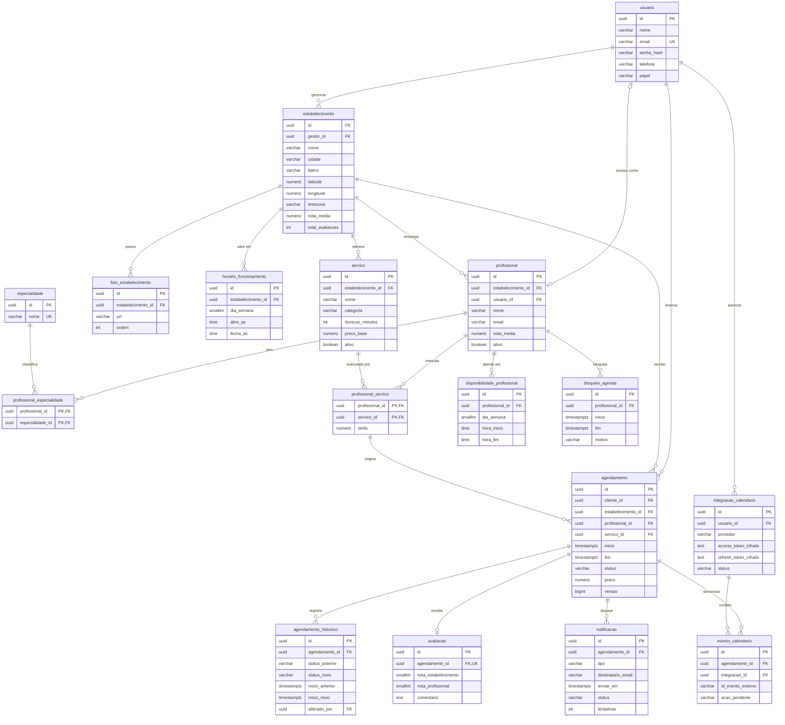
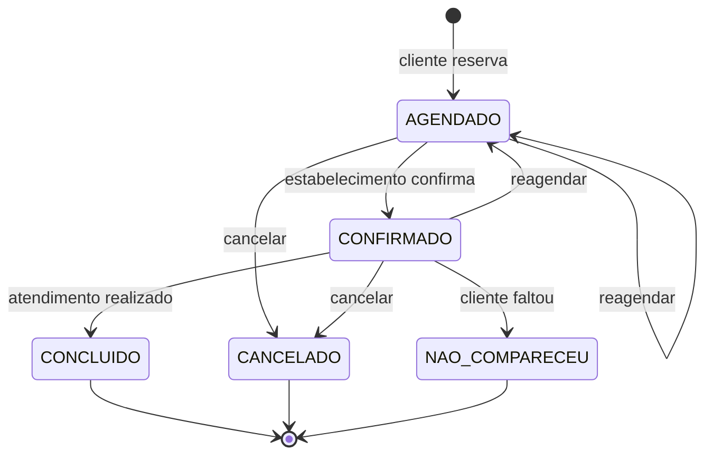

# Modelagem de Dados

Sistema de agendamento e gerenciamento de serviços de beleza e bem-estar (Tech Challenge Java, Fase 3, Substitutiva).

Documentos relacionados: [Arquitetura do Sistema](arquitetura-do-sistema.md) · [Planejamento de Desenvolvimento](planejamento-de-desenvolvimento.md)

## 1. Premissas

- **Banco:** PostgreSQL 16, versionado com migrações Flyway.
- **Identificadores:** `uuid` em todas as tabelas, gerado pela aplicação.
- **Datas e horas:** instantes em `timestamptz` (UTC). Horários recorrentes, como funcionamento e disponibilidade, usam `time` no fuso do estabelecimento (`estabelecimento.timezone`).
- **Valores monetários:** `numeric(10,2)`, em reais.
- **Enumerações:** `varchar` com `CHECK`, o que simplifica as migrações em relação a tipos `ENUM` nativos.
- **Auditoria:** as tabelas principais têm `criado_em` e `atualizado_em`. Esses campos ficam fora do diagrama para facilitar a leitura.
- **Simplificações de escopo:**
  - Um profissional pertence a um único estabelecimento.
  - Um estabelecimento tem um único gestor.
  - Cada agendamento contém um único serviço.

## 2. Diagrama entidade-relacionamento



## 3. Dicionário de dados

Colunas são `NOT NULL`, exceto quando marcadas como **nula**.

### 3.1 Identidade

**`usuario`**: conta de acesso ao sistema.

| Coluna | Tipo | Restrições |
|---|---|---|
| `id` | `uuid` | PK |
| `nome` | `varchar(120)` | |
| `email` | `varchar(180)` | Único, sempre em minúsculas |
| `senha_hash` | `varchar(100)` | BCrypt |
| `telefone` | `varchar(20)` | Nula |
| `papel` | `varchar(20)` | `CLIENTE`, `PROFISSIONAL` ou `GESTOR` |

### 3.2 Estabelecimentos

**`estabelecimento`**

| Coluna | Tipo | Restrições |
|---|---|---|
| `id` | `uuid` | PK |
| `gestor_id` | `uuid` | FK `usuario` |
| `nome` | `varchar(150)` | |
| `descricao` | `text` | Nula |
| `logradouro` | `varchar(150)` | |
| `numero` | `varchar(10)` | |
| `complemento` | `varchar(80)` | Nula |
| `bairro` | `varchar(80)` | |
| `cidade` | `varchar(80)` | |
| `uf` | `char(2)` | |
| `cep` | `char(8)` | |
| `latitude` | `numeric(9,6)` | Nula, entre -90 e 90 |
| `longitude` | `numeric(9,6)` | Nula, entre -180 e 180 |
| `timezone` | `varchar(50)` | Padrão `America/Sao_Paulo` |
| `nota_media` | `numeric(3,2)` | Nula até a primeira avaliação |
| `total_avaliacoes` | `int` | Padrão 0 |
| `ativo` | `boolean` | Padrão `true` |

**`foto_estabelecimento`**

| Coluna | Tipo | Restrições |
|---|---|---|
| `id` | `uuid` | PK |
| `estabelecimento_id` | `uuid` | FK, `ON DELETE CASCADE` |
| `url` | `varchar(500)` | Endereço do objeto no S3 ou MinIO |
| `ordem` | `int` | Único com `estabelecimento_id` |

**`horario_funcionamento`**

| Coluna | Tipo | Restrições |
|---|---|---|
| `id` | `uuid` | PK |
| `estabelecimento_id` | `uuid` | FK, `ON DELETE CASCADE` |
| `dia_semana` | `smallint` | 1 (segunda) a 7 (domingo), ISO-8601 |
| `abre_as` | `time` | |
| `fecha_as` | `time` | `CHECK (fecha_as > abre_as)` |

Único em `(estabelecimento_id, dia_semana)`. Dia sem registro significa fechado.

**`servico`**

| Coluna | Tipo | Restrições |
|---|---|---|
| `id` | `uuid` | PK |
| `estabelecimento_id` | `uuid` | FK |
| `nome` | `varchar(120)` | |
| `descricao` | `text` | Nula |
| `categoria` | `varchar(40)` | `CABELO`, `UNHAS`, `ESTETICA`, `MASSAGEM`, `BARBA`, `OUTROS` |
| `duracao_minutos` | `int` | `CHECK (duracao_minutos > 0)` |
| `preco_base` | `numeric(10,2)` | `CHECK (preco_base >= 0)` |
| `ativo` | `boolean` | Padrão `true` |

### 3.3 Profissionais

**`profissional`**

| Coluna | Tipo | Restrições |
|---|---|---|
| `id` | `uuid` | PK |
| `estabelecimento_id` | `uuid` | FK |
| `usuario_id` | `uuid` | FK, nula, única. Preenchida quando o profissional tem login |
| `nome` | `varchar(120)` | |
| `email` | `varchar(180)` | Destino das notificações |
| `bio` | `text` | Nula |
| `nota_media` | `numeric(3,2)` | Nula até a primeira avaliação |
| `total_avaliacoes` | `int` | Padrão 0 |
| `ativo` | `boolean` | Padrão `true` |

**`especialidade`**: `id` (PK) e `nome` (`varchar(80)`, único).

**`profissional_especialidade`**: `profissional_id` e `especialidade_id`, ambos FK, formando a PK composta.

**`profissional_servico`**: serviços que o profissional executa e a tarifa de cada um.

| Coluna | Tipo | Restrições |
|---|---|---|
| `profissional_id` | `uuid` | PK, FK |
| `servico_id` | `uuid` | PK, FK |
| `tarifa` | `numeric(10,2)` | `CHECK (tarifa >= 0)`. O caso de uso assume `preco_base` quando nenhuma tarifa é informada |

**`disponibilidade_profissional`**: jornada semanal recorrente. Aceita mais de um período por dia, como manhã e tarde.

| Coluna | Tipo | Restrições |
|---|---|---|
| `id` | `uuid` | PK |
| `profissional_id` | `uuid` | FK, `ON DELETE CASCADE` |
| `dia_semana` | `smallint` | 1 a 7 |
| `hora_inicio` | `time` | |
| `hora_fim` | `time` | `CHECK (hora_fim > hora_inicio)` |

**`bloqueio_agenda`**: ausência pontual, como férias ou folga.

| Coluna | Tipo | Restrições |
|---|---|---|
| `id` | `uuid` | PK |
| `profissional_id` | `uuid` | FK, `ON DELETE CASCADE` |
| `inicio` | `timestamptz` | |
| `fim` | `timestamptz` | `CHECK (fim > inicio)` |
| `motivo` | `varchar(150)` | Nula |

### 3.4 Agendamentos

**`agendamento`**

| Coluna | Tipo | Restrições |
|---|---|---|
| `id` | `uuid` | PK |
| `cliente_id` | `uuid` | FK `usuario` |
| `estabelecimento_id` | `uuid` | FK. Redundância proposital para as consultas do painel |
| `profissional_id` | `uuid` | FK composta com `servico_id` para `profissional_servico` |
| `servico_id` | `uuid` | Idem |
| `inicio` | `timestamptz` | |
| `fim` | `timestamptz` | `CHECK (fim > inicio)` |
| `status` | `varchar(20)` | `AGENDADO`, `CONFIRMADO`, `CONCLUIDO`, `CANCELADO`, `NAO_COMPARECEU` |
| `preco` | `numeric(10,2)` | Tarifa congelada no momento da reserva |
| `observacoes` | `varchar(500)` | Nula |
| `versao` | `bigint` | Bloqueio otimista |

**`agendamento_historico`**: trilha de alterações, somente inserção.

| Coluna | Tipo | Restrições |
|---|---|---|
| `id` | `uuid` | PK |
| `agendamento_id` | `uuid` | FK |
| `status_anterior` | `varchar(20)` | Nula na criação |
| `status_novo` | `varchar(20)` | |
| `inicio_anterior` | `timestamptz` | Nula, preenchida no reagendamento |
| `inicio_novo` | `timestamptz` | Nula, preenchida no reagendamento |
| `motivo` | `varchar(250)` | Nula |
| `alterado_por` | `uuid` | FK `usuario` |
| `ocorrido_em` | `timestamptz` | |

### 3.5 Avaliações

**`avaliacao`**

| Coluna | Tipo | Restrições |
|---|---|---|
| `id` | `uuid` | PK |
| `agendamento_id` | `uuid` | FK, única |
| `estabelecimento_id` | `uuid` | FK. Redundância para listagem |
| `profissional_id` | `uuid` | FK. Redundância para listagem |
| `cliente_id` | `uuid` | FK `usuario` |
| `nota_estabelecimento` | `smallint` | `CHECK (nota_estabelecimento BETWEEN 1 AND 5)` |
| `nota_profissional` | `smallint` | `CHECK (nota_profissional BETWEEN 1 AND 5)` |
| `comentario` | `text` | Nula |

### 3.6 Notificações

**`notificacao`**: outbox de e-mails. É gravada na mesma transação do agendamento e enviada depois por um job.

| Coluna | Tipo | Restrições |
|---|---|---|
| `id` | `uuid` | PK |
| `agendamento_id` | `uuid` | FK |
| `tipo` | `varchar(20)` | `CONFIRMACAO`, `LEMBRETE`, `REAGENDAMENTO`, `CANCELAMENTO` |
| `destinatario_email` | `varchar(180)` | |
| `assunto` | `varchar(200)` | |
| `corpo` | `text` | |
| `enviar_em` | `timestamptz` | Imediato ou, nos lembretes, 24 horas antes do início |
| `status` | `varchar(20)` | `PENDENTE`, `ENVIADA`, `FALHA`, `CANCELADA` |
| `tentativas` | `int` | Padrão 0. Vira `FALHA` após 5 tentativas |
| `enviada_em` | `timestamptz` | Nula |
| `ultimo_erro` | `text` | Nula |

### 3.7 Calendário

**`integracao_calendario`**: autorização OAuth2 concedida por um cliente ou profissional.

| Coluna | Tipo | Restrições |
|---|---|---|
| `id` | `uuid` | PK |
| `usuario_id` | `uuid` | FK. Único com `provedor` |
| `provedor` | `varchar(20)` | `GOOGLE`. O campo permite incluir Outlook depois |
| `access_token_cifrado` | `text` | AES-GCM |
| `refresh_token_cifrado` | `text` | AES-GCM |
| `expira_em` | `timestamptz` | Validade do access token |
| `calendario_id` | `varchar(200)` | Padrão `primary` |
| `status` | `varchar(20)` | `ATIVA` ou `REVOGADA` |

**`evento_calendario`**: vínculo entre o agendamento e o evento no provedor externo. Também funciona como fila de sincronização.

| Coluna | Tipo | Restrições |
|---|---|---|
| `id` | `uuid` | PK |
| `agendamento_id` | `uuid` | FK. Único com `integracao_id` |
| `integracao_id` | `uuid` | FK |
| `id_evento_externo` | `varchar(200)` | Nula até a primeira sincronização |
| `acao_pendente` | `varchar(20)` | `CRIAR`, `ATUALIZAR`, `REMOVER` ou `NENHUMA` |
| `tentativas` | `int` | Padrão 0 |
| `ultimo_erro` | `text` | Nula |

## 4. Regras de integridade

### 4.1 Impedir dupla reserva

A regra mais importante do modelo fica no banco, porque verificar antes de inserir não resolve duas requisições simultâneas:

```sql
CREATE EXTENSION IF NOT EXISTS btree_gist;

ALTER TABLE agendamento
  ADD CONSTRAINT agendamento_sem_conflito
  EXCLUDE USING gist (
    profissional_id WITH =,
    tstzrange(inicio, fim, '[)') WITH &&
  )
  WHERE (status IN ('AGENDADO', 'CONFIRMADO'));
```

- O intervalo `[)` permite que um atendimento comece no instante exato em que o anterior termina.
- Agendamentos cancelados, concluídos ou sem comparecimento liberam o horário.
- A violação gera o erro `23P01`, que a aplicação converte em HTTP 409.

### 4.2 Status do agendamento



O domínio valida essas transições, e cada uma grava uma linha em `agendamento_historico`.

### 4.3 Regras validadas nos casos de uso

Estas regras envolvem mais de uma tabela ou dependem de horário e, por isso, não usam `CHECK`:

- Um agendamento só é aceito se o horário estiver dentro do funcionamento e da disponibilidade do profissional, sem bloqueio e no futuro.
- O `fim` é calculado como `inicio + servico.duracao_minutos`.
- A avaliação só é permitida para agendamento `CONCLUIDO` e pelo cliente daquele agendamento. A restrição única em `agendamento_id` garante uma avaliação por atendimento.
- O profissional e o serviço precisam pertencer ao `estabelecimento_id` informado.
- A criação de um bloqueio é recusada se houver agendamento ativo no período.
- Reagendar ou cancelar marca os lembretes pendentes como `CANCELADA`. O reagendamento cria novos lembretes.
- `nota_media` e `total_avaliacoes` são atualizados na mesma transação da avaliação, para evitar recalcular as médias em cada busca.

### 4.4 Horários livres

Os horários livres são calculados, não armazenados:

```text
horários livres = (disponibilidade ∩ funcionamento) − bloqueios − agendamentos ativos
```

Os candidatos são gerados em passos de 15 minutos, e cada um precisa comportar a duração do serviço escolhido.

## 5. Índices

```sql
CREATE EXTENSION IF NOT EXISTS pg_trgm;

-- Busca por nome e serviço
CREATE INDEX idx_estabelecimento_nome_trgm ON estabelecimento USING gin (nome gin_trgm_ops);
CREATE INDEX idx_servico_nome_trgm ON servico USING gin (nome gin_trgm_ops);
CREATE INDEX idx_servico_categoria ON servico (categoria) WHERE ativo;

-- Filtros de localização, avaliação e preço
CREATE INDEX idx_estabelecimento_cidade_bairro ON estabelecimento (cidade, bairro) WHERE ativo;
CREATE INDEX idx_estabelecimento_lat_lng ON estabelecimento (latitude, longitude) WHERE ativo;
CREATE INDEX idx_estabelecimento_nota ON estabelecimento (nota_media DESC NULLS LAST) WHERE ativo;
CREATE INDEX idx_profissional_servico_tarifa ON profissional_servico (servico_id, tarifa);

-- Painel e histórico do cliente
CREATE INDEX idx_agendamento_estab_inicio ON agendamento (estabelecimento_id, inicio);
CREATE INDEX idx_agendamento_cliente_inicio ON agendamento (cliente_id, inicio DESC);
CREATE INDEX idx_bloqueio_prof_periodo ON bloqueio_agenda (profissional_id, inicio, fim);

-- Avaliações
CREATE INDEX idx_avaliacao_estab ON avaliacao (estabelecimento_id, criado_em DESC);
CREATE INDEX idx_avaliacao_prof ON avaliacao (profissional_id, criado_em DESC);

-- Filas processadas pelos jobs
CREATE INDEX idx_notificacao_pendente ON notificacao (enviar_em) WHERE status = 'PENDENTE';
CREATE INDEX idx_evento_pendente ON evento_calendario (atualizado_em) WHERE acao_pendente <> 'NENHUMA';
```

A restrição `agendamento_sem_conflito` cria um índice GiST em `(profissional_id, intervalo)`, que também atende à consulta de horários ocupados dos agendamentos ativos.

### Busca por distância

A distância usa a fórmula de Haversine em SQL. Um filtro prévio por faixa de latitude e longitude reduz as linhas calculadas. PostGIS ficou de fora porque o volume esperado não justifica mais uma dependência.

## 6. Migrações Flyway

| Migração | Conteúdo | Data prevista |
|---|---|---|
| `V1__extensoes_e_usuario.sql` | `btree_gist`, `pg_trgm`, `usuario` | 04/11 |
| `V2__estabelecimentos.sql` | `estabelecimento`, `foto_estabelecimento`, `horario_funcionamento`, `servico` | 07/11 |
| `V3__profissionais.sql` | `profissional`, `especialidade`, `profissional_especialidade`, `profissional_servico` | 10/11 |
| `V4__disponibilidade.sql` | `disponibilidade_profissional`, `bloqueio_agenda` | 12/11 |
| `V5__agendamentos.sql` | `agendamento`, `agendamento_historico`, restrição de conflito | 14/11 |
| `V6__notificacoes.sql` | `notificacao` | 16/11 |
| `V7__avaliacoes.sql` | `avaliacao` | 19/11 |
| `V8__indices_busca.sql` | Índices de busca e filtros | 20/11 |
| `V9__calendario.sql` | `integracao_calendario`, `evento_calendario` | 21/11 |

## 7. Funcionalidades x tabelas

| Funcionalidade do enunciado | Tabelas |
|---|---|
| 1. Cadastro de estabelecimentos | `estabelecimento`, `foto_estabelecimento`, `horario_funcionamento`, `servico`, `profissional` |
| 2. Perfil de profissionais | `profissional`, `especialidade`, `profissional_especialidade`, `profissional_servico`, `disponibilidade_profissional`, `bloqueio_agenda` |
| 3. Agendamento, confirmações e lembretes | `agendamento`, `agendamento_historico`, `notificacao` |
| 4. Avaliações e comentários | `avaliacao`, além dos agregados em `estabelecimento` e `profissional` |
| 5. Busca e filtragem | `estabelecimento`, `servico`, `profissional_servico`, `disponibilidade_profissional`, `agendamento` |
| 6. Gerenciamento de agendamentos | `agendamento`, `agendamento_historico` |
| 7. Integração com calendários | `integracao_calendario`, `evento_calendario` |
