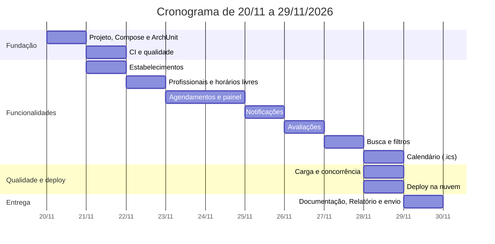

# Planejamento de Desenvolvimento

Sistema de agendamento e gerenciamento de serviços de beleza e bem-estar (Tech Challenge Java, Fase 3, Substitutiva).

Documentos relacionados: [Modelagem de Dados](modelagem-de-dados.md) · [Arquitetura do Sistema](arquitetura-do-sistema.md)

> **Revisão de 20/11/2026.** O plano original (02/11 a 29/11, cerca de 84h) não foi executado. Até hoje só existem o esqueleto do projeto Spring Boot, os perfis `dev` e `production` e um Dockerfile, todos de 02/11. Restam 10 dias e cerca de 34h. Por isso, este plano corta o escopo antes de começar, em vez de cortar durante o desenvolvimento (seção 2).

## 1. Resumo

| Item | Definição |
|---|---|
| Período | 20/11/2026 (sexta, feriado) a 29/11/2026 (domingo) |
| Peso | 60% da nota de todas as disciplinas da fase |
| Dedicação | Cerca de 2h por dia útil e 5,5h por dia de fim de semana |
| Capacidade total | Cerca de 34h: 6 dias úteis (12h) e 4 dias de fim de semana (22h) |
| Trabalho planejado | Cerca de 32,5h. Restam 1,5h de reserva em 29/11 |
| Entrega | PDF com link do GitHub, Documentação Técnica e Relatório Técnico |

A folga é pequena demais. **Cada hora extra (feriado de 20/11 e noites de dias úteis) vira reserva**, e é a única forma de recuperar os itens adiados da seção 2.2.

### 1.1 Ponto de partida

| Item | Situação |
|---|---|
| Projeto Spring Boot 4.1 com Java 21 e Maven | Pronto |
| Perfis `dev` e `production` | Pronto |
| Dockerfile | Com erros: imagens com Java 17, nome do `.jar` sem extensão e estágio `runtime-base` inexistente |
| Repositório no GitHub | Existe. Falta confirmar que está público |
| `docker-compose.yml`, CI, Flyway, Swagger, testes | Não iniciado |

## 2. Decisões de escopo

### 2.1 Simplificações aplicadas desde já

Estas trocas substituem decisões da [Arquitetura do Sistema](arquitetura-do-sistema.md). Todas atendem ao enunciado e devem aparecer no Relatório Técnico como decisões conscientes.

| Antes | Agora | Motivo |
|---|---|---|
| OAuth2 e sincronização com a API do Google Calendar | Feed iCalendar (`.ics`) por profissional e por cliente, com URL secreta | Google Calendar e Outlook assinam o mesmo feed. Atende aos dois sem OAuth, sem tokens e sem projeto no Google Cloud |
| Outbox com job e `SKIP LOCKED` | E-mail enviado depois do commit (`@TransactionalEventListener` + `@Async`) e job `@Scheduled` para lembretes | Menos tabelas e jobs, com o mesmo comportamento visível |
| AWS ECS com Terraform, ALB, CloudFront e RDS | Docker Compose local e plataforma em nuvem gratuita (Render, Railway ou similar) com PostgreSQL gerenciado | O enunciado aceita "uma opção gratuita". Sem custo e sem infraestrutura como código |
| Fotos em S3/MinIO | Fotos como URLs no cadastro | Tira o MinIO e o gateway de armazenamento |
| Busca com `pg_trgm` e raio de distância | Consultas com JPA Specification: nome, cidade, bairro, serviço, nota, faixa de preço e disponibilidade | Atende ao item 5 sem extensão do banco nem geolocalização |
| Login com JWT e papéis | Usuário identificado pelo cabeçalho `X-Usuario-Id` e papel informado no cadastro | Autenticação não é critério de avaliação. Registrar a limitação no Relatório |

### 2.2 Itens adiados (entram somente se sobrar tempo, nesta ordem)

1. Autenticação com JWT e Spring Security.
2. Deploy na AWS ECS, mesmo sem Terraform.
3. Upload de fotos para S3/MinIO.

## 3. Marcos

| Marco | Data | Resultado esperado |
|---|---|---|
| **M0** | 20/11 | Projeto sobe com Docker Compose, e as regras ArchUnit rodam |
| **M1** | 22/11 | CI completo e funcionalidades 1 e 2 prontas, com horários livres e primeira feature BDD |
| **M2** | 25/11 | Funcionalidades 3 e 6 prontas: agendamento, painel, confirmações e lembretes |
| **M3 e congelamento** | 28/11 | As 7 funcionalidades prontas, carga medida e sistema na nuvem. A partir daqui, somente correções |
| **Entrega** | 29/11 | PDF revisado e enviado **até as 14h** |

## 4. Definição de pronto

Uma tarefa de funcionalidade só termina quando:

- [ ] Os testes de `domain` e `application` foram escritos antes do código (commit `test:` seguido de `feat:`).
- [ ] A cobertura de `domain` e `application` está em 80% ou mais.
- [ ] O endpoint tem teste de controller (MockMvc) e aparece no Swagger com descrição e códigos de erro.
- [ ] O CI está verde e sem novos problemas críticos no Sonar.

BDD fica restrito aos fluxos principais: estabelecimento, agendamento e avaliação.

**Rotina diária de 5 minutos:** anotar em `docs/diario.md` os desafios e soluções do dia. Essas notas viram a base do Relatório Técnico, que precisa ser escrito em poucas horas no dia 29.

## 5. Metas por dia

#### Sex 20/11 (2h, feriado): fundação. Marco M0

- [x] Corrigir o Dockerfile: Java 21 nas duas imagens, nome do `.jar` e estágios.
- [x] Criar `docker-compose.yml` com PostgreSQL, Mailpit e a aplicação.
- [x] Adicionar Flyway, Actuator, springdoc-openapi, Testcontainers, ArchUnit e Cucumber ao `pom.xml`.
- [x] Criar a estrutura de pacotes e as regras ArchUnit da arquitetura.
- [x] Confirmar que o repositório está público e integrar a branch na `master`.

**Pronto quando:** `docker compose up` sobe a aplicação, `/actuator/health` responde `UP`, e os testes ArchUnit passam.

#### Sáb 21/11 (5,5h): CI e estabelecimentos

- [x] Criar workflow do GitHub Actions com build, testes, JaCoCo e SonarCloud (1,5h).
- [x] Em TDD: `Estabelecimento`, `HorarioFuncionamento` e `Servico`, com fotos como URLs, e os casos de uso de cadastro e atualização (1,5h).
- [x] Criar migração `V1`, adaptadores JPA e teste de repositório com Testcontainers (1h).
- [x] Publicar os endpoints de estabelecimento, horários e serviços, com testes de controller (1,5h).

**Pronto quando:** o CI roda em cada push com análise do Sonar, e o gestor cadastra estabelecimento, horários, serviços e fotos pela API. **Funcionalidade 1 pronta.**

#### Dom 22/11 (5,5h): profissionais e horários livres. Marco M1

- [ ] Em TDD: `Profissional`, especialidades, tarifas por serviço e jornada de trabalho (1,5h).
- [ ] Criar migração `V2`, adaptadores e endpoints de perfil (1h).
- [ ] Em TDD: `AgendaProfissional`, cruzando jornada, funcionamento, bloqueios e agendamentos. Cobrir almoço, serviço que não cabe no fim da jornada e dia fechado (1,5h).
- [ ] Publicar `GET /profissionais/{id}/horarios-livres` (0,5h).
- [ ] Configurar Cucumber com RestAssured e escrever a feature de cadastro de estabelecimento (1h).

**Pronto quando:** os itens do **M1** estão atendidos, e a primeira feature roda no CI. **Funcionalidade 2 pronta.**

#### Seg 23/11 (2h): criar agendamento

- [ ] Em TDD: `Agendamento` e a máquina de status, com transições válidas e inválidas.
- [ ] Criar migração `V3`, com a restrição `EXCLUDE` contra conflito de horário.
- [ ] Implementar `CriarAgendamentoUseCase`, com tradução do erro `23P01`, e publicar `POST /agendamentos` e `GET /agendamentos/meus`.

**Pronto quando:** um agendamento em horário ocupado é recusado com 409.

#### Ter 24/11 (2h): gestão e painel

- [ ] Implementar confirmar, cancelar, reagendar, concluir e registrar não comparecimento, com histórico.
- [ ] Publicar o painel do estabelecimento: agenda filtrada por data, profissional e status, e resumo do dia.

**Pronto quando:** toda transição fora do diagrama da modelagem é recusada, e o painel mostra a agenda atualizada. **Funcionalidade 6 pronta.**

#### Qua 25/11 (2h): confirmações e lembretes. Marco M2

- [ ] Criar `NotificacaoGateway` com adaptador SMTP (Mailpit local).
- [ ] Enviar confirmação para cliente e profissional depois do commit da reserva, do cancelamento e do reagendamento.
- [ ] Criar job `@Scheduled` de lembretes para 24h antes, com marcação de envio para não repetir.
- [ ] Testar com GreenMail.

**Pronto quando:** uma reserva gera e-mails visíveis no Mailpit, e um agendamento cancelado não recebe lembrete. **Funcionalidade 3 pronta.**

#### Qui 26/11 (2h): avaliações

- [ ] Em TDD: `Avaliacao` e o caso de uso de avaliar. Recusar nota fora de 1 a 5, agendamento não concluído e cliente diferente.
- [ ] Criar migração `V4`, endpoints de criar e listar e atualização da nota média na mesma transação.
- [ ] Escrever a feature BDD de avaliação.

**Pronto quando:** a nota média muda após uma avaliação, e uma segunda avaliação do mesmo agendamento é recusada. **Funcionalidade 4 pronta.**

#### Sex 27/11 (2h): busca e filtros

- [ ] Criar migração `V5` com índices.
- [ ] Publicar `GET /busca/estabelecimentos` com nome, cidade, bairro, serviço, nota mínima, faixa de preço e disponibilidade em uma data, com paginação.

**Pronto quando:** os filtros funcionam combinados, e a resposta é paginada. **Funcionalidade 5 pronta.**

#### Sáb 28/11 (5,5h): calendário, carga e nuvem. Marco M3 e congelamento

- [ ] Criar `CalendarioGateway` e publicar o feed `.ics` com token secreto para profissional e cliente. Testar a assinatura no Google Calendar (1,5h).
- [ ] Escrever a feature BDD de agendamento (0,5h).
- [ ] Criar teste de concorrência com Testcontainers e um cenário Gatling de reservas simultâneas e outro de busca. Guardar os relatórios (1,5h).
- [ ] Publicar na plataforma gratuita com o perfil `production` e PostgreSQL gerenciado (2h).
- [ ] Parar de incluir funcionalidades.

**Pronto quando:** em N reservas simultâneas no mesmo horário, exatamente uma é aceita, e o Swagger abre pelo endereço público. **Funcionalidade 7 pronta e os itens do M3 atendidos.**

#### Dom 29/11 (5,5h): documentação, Relatório e envio

- [ ] Gerar o Javadoc e revisar o Swagger (0,5h).
- [ ] Escrever a Documentação Técnica e o Relatório Técnico a partir do diário: tecnologias, desafios, soluções, Clean Architecture, qualidade e as decisões da seção 2 (2,5h).
- [ ] Testar o README em um clone limpo e abrir o GitHub em janela anônima (0,5h).
- [ ] Montar o PDF, conferir com a seção 6 e **enviar até as 14h** (0,5h).

**Pronto quando:** o portal confirma o envio. As horas restantes (1,5h) ficam para imprevistos.

## 6. Lista de conferência da entrega

**PDF**

- [ ] Link do repositório GitHub, com acesso público e código completo.
- [ ] Documentação Técnica do sistema e da API (Swagger e Javadoc).
- [ ] Relatório Técnico: tecnologias, ferramentas, desafios e soluções, com ênfase em Clean Architecture e qualidade.

**Critérios de avaliação**

| Critério | Evidência | Meta em |
|---|---|---|
| Clean Architecture | Pacotes, regras ArchUnit, Relatório | 20/11 em diante |
| TDD e cobertura | Histórico de commits, relatório JaCoCo | 21/11 em diante |
| Testes integrados e análise estática | Testcontainers, SonarCloud | 21/11 em diante |
| Controllers, CI e BDD | Testes MockMvc, features Cucumber, execuções no Actions | 22/11 em diante |
| Performance e carga | Teste de concorrência e relatórios Gatling | 28/11 |
| Deploy local e em nuvem | Docker Compose, plataforma gratuita | 20/11 e 28/11 |

**Funcionalidades**

| Funcionalidade | Concluída em |
|---|---|
| 1. Cadastro de estabelecimentos | 21/11 |
| 2. Perfil de profissionais | 22/11 |
| 3. Agendamento, confirmações e lembretes | 25/11 |
| 4. Avaliações e comentários | 26/11 |
| 5. Busca e filtragem | 27/11 |
| 6. Gerenciamento de agendamentos | 24/11 |
| 7. Integração com calendários | 28/11 |

## 7. Riscos

| Risco | Impacto | Resposta |
|---|---|---|
| Atraso em qualquer dia útil, com só 2h e sem folga entre os dias | Alto | Usar a noite seguinte ou o fim de semana. Se o atraso passar de meio dia, aplicar a seção 8 |
| Plataforma gratuita com limitações (hibernação, memória, banco expirado) | Médio | Testar o deploy cedo no dia 28. Registrar as limitações no Relatório. Docker Compose local continua como evidência |
| Spring Boot 4 com bibliotecas ainda incompatíveis (springdoc, Cucumber) | Médio | Validar as dependências em 20/11. Se falhar, voltar para Spring Boot 3.5 no mesmo dia |
| Relatório escrito com pressa no último dia | Médio | Manter o diário todos os dias |
| Horário limite do envio desconhecido | Alto | Confirmar no portal da FIAP e enviar até as 14h de 29/11 |

## 8. Ordem de corte de escopo

Se um marco atrasar mais de meio dia, aplique os cortes nesta ordem:

1. **Filtro por disponibilidade na busca** → busca pelos demais filtros.
2. **Reagendamento como operação própria** → cancelar e criar um novo agendamento.
3. **Feed `.ics` do cliente** → feed apenas do profissional.
4. **Segundo cenário Gatling (busca)** → somente reservas simultâneas.
5. **Deploy na nuvem** → somente Docker Compose local, com a limitação registrada no Relatório.

Os itens avaliados diretamente não entram no corte: Clean Architecture, TDD, testes integrados, BDD, CI, ao menos um teste de carga e deploy local.
