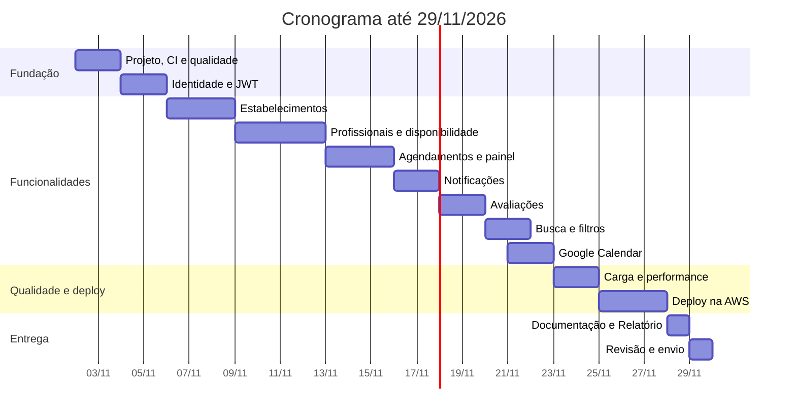

# Planejamento de Desenvolvimento

Sistema de agendamento e gerenciamento de serviços de beleza e bem-estar (Tech Challenge Java, Fase 3, Substitutiva).

Documentos relacionados: [Modelagem de Dados](modelagem-de-dados.md) · [Arquitetura do Sistema](arquitetura-do-sistema.md)

## 1. Resumo

| Item | Definição |
|---|---|
| Período | 02/11/2026 (segunda) a 29/11/2026 (domingo) |
| Peso | 60% da nota de todas as disciplinas da fase |
| Dedicação | Cerca de 2h por dia útil e 5 a 6h por dia de fim de semana |
| Capacidade total | Cerca de 84h (20 dias úteis e 8 dias de fim de semana) |
| Entrega | PDF com link do GitHub, Documentação Técnica e Relatório Técnico |

Os feriados de 02/11 e 20/11 mantêm a carga de dia útil. Qualquer hora extra nessas datas vira folga para o cronograma.

## 2. Marcos

| Marco | Data | Resultado esperado |
|---|---|---|
| **M1** | 08/11 | CI completo, autenticação e cadastro de estabelecimentos funcionando |
| **M2** | 15/11 | Perfil de profissionais, agendamento sem conflito e painel prontos |
| **M3** | 22/11 | As 7 funcionalidades do enunciado completas |
| **Congelamento** | 27/11 | Sistema na AWS. A partir daqui, somente correções |
| **M4** | 28/11 | Documentação, Relatório e PDF final prontos |
| **Entrega** | 29/11 | PDF revisado e enviado |

## 3. Definição de pronto

Uma tarefa de funcionalidade só termina quando:

- [ ] Os testes foram escritos antes do código (commit `test:` seguido de `feat:`).
- [ ] A cobertura de `domain` e `application` está em 80% ou mais.
- [ ] O endpoint está anotado no Swagger, com exemplos e códigos de erro.
- [ ] O CI está verde e sem novos problemas críticos no Sonar.
- [ ] O fluxo principal tem cenário BDD.

**Rotina diária de 5 minutos:** anotar em `docs/diario.md` os desafios e soluções do dia. Essas notas viram a base do Relatório Técnico.

## 4. Metas por dia

### Semana 1: fundação e estabelecimentos (02/11 a 08/11)

#### Seg 02/11 (2h): projeto iniciado

- [ ] Criar repositório público no GitHub e projeto Spring Boot com Java 21 e Maven.
- [ ] Criar `docker-compose.yml` com PostgreSQL, Mailpit e MinIO.
- [ ] Criar a estrutura de pacotes dos módulos.

**Pronto quando:** `docker compose up` e a aplicação sobem, e `/actuator/health` responde `UP`.

#### Ter 03/11 (2h): qualidade automatizada

- [ ] Criar workflow do GitHub Actions com build e testes.
- [ ] Configurar JaCoCo, Checkstyle, SpotBugs e SonarCloud.
- [ ] Escrever as regras ArchUnit da arquitetura.

**Pronto quando:** o CI roda em cada push, e uma violação de camada proposital faz o build falhar.

#### Qua 04/11 (2h): domínio de usuário

- [ ] Em TDD: entidade `Usuario` e caso de uso de registro.
- [ ] Criar migração `V1` e adaptador de persistência.
- [ ] Publicar `POST /auth/registro`.

**Pronto quando:** o registro funciona de ponta a ponta e recusa e-mail duplicado.

#### Qui 05/11 (2h): autenticação

- [ ] Publicar `POST /auth/login` com JWT.
- [ ] Configurar Spring Security e papéis.
- [ ] Configurar o Swagger com autenticação Bearer.

**Pronto quando:** uma rota protegida responde 401 sem token e 403 com papel errado.

#### Sex 06/11 (2h): domínio de estabelecimento

- [ ] Em TDD: `Estabelecimento`, `HorarioFuncionamento`, `Servico`.
- [ ] Em TDD: casos de uso de cadastro e atualização, com verificação de posse.

**Pronto quando:** os testes unitários passam, sem Spring e sem banco.

#### Sáb 07/11 (5,5h): API de estabelecimentos

- [ ] Criar migração `V2` e adaptadores JPA.
- [ ] Publicar endpoints de estabelecimento, horários e serviços.
- [ ] Configurar Testcontainers e cobrir os repositórios.

**Pronto quando:** o gestor cadastra estabelecimento, horários e serviços pela API, e os testes integrados rodam no CI.

#### Dom 08/11 (5,5h): fotos e BDD. Marco M1

- [ ] Criar `ArmazenamentoFotosGateway` com adaptador MinIO/S3 e upload de fotos.
- [ ] Configurar Cucumber com RestAssured.
- [ ] Escrever a primeira feature: cadastro de estabelecimento.
- [ ] Criar o README com instruções de execução.
- [ ] Revisar o marco e ajustar o cronograma.

**Pronto quando:** os itens do **M1** estão atendidos e a primeira feature roda no CI.

### Semana 2: profissionais e agendamento (09/11 a 15/11)

#### Seg 09/11 (2h): domínio de profissional

- [ ] Em TDD: `Profissional`, `Especialidade` e tarifas por serviço.
- [ ] Em TDD: casos de uso de cadastro e atualização de perfil.

**Pronto quando:** a regra de tarifa padrão e a posse pelo gestor têm testes passando.

#### Ter 10/11 (2h): API de profissional

- [ ] Criar migração `V3` e adaptadores.
- [ ] Publicar endpoints de perfil, especialidades e serviços.

**Pronto quando:** o perfil completo é criado e consultado pela API.

#### Qua 11/11 (2h): cálculo de horários livres

- [ ] Em TDD: `AgendaProfissional`, cruzando disponibilidade, funcionamento, bloqueios e agendamentos.
- [ ] Cobrir casos de borda: intervalo de almoço, serviço que não cabe no fim da jornada, dia fechado, fuso.

**Pronto quando:** os casos de borda passam em testes unitários puros.

#### Qui 12/11 (2h): API de disponibilidade

- [ ] Criar migração `V4` e adaptadores.
- [ ] Publicar endpoints de jornada e bloqueios.
- [ ] Publicar `GET /profissionais/{id}/horarios-livres`.

**Pronto quando:** um bloqueio criado some da lista de horários livres.

#### Sex 13/11 (2h): domínio de agendamento

- [ ] Em TDD: `Agendamento` e a máquina de status.
- [ ] Testar transições válidas e inválidas.

**Pronto quando:** toda transição fora do diagrama da modelagem é recusada.

#### Sáb 14/11 (5,5h): criar agendamento

- [ ] Criar migração `V5`, incluindo a restrição de conflito.
- [ ] Implementar `CriarAgendamentoUseCase` e o adaptador, com tradução do erro `23P01`.
- [ ] Publicar `POST /agendamentos` e `GET /agendamentos/meus`.
- [ ] Criar teste de concorrência com Testcontainers.

**Pronto quando:** em N reservas simultâneas no mesmo horário, exatamente uma é aceita.

#### Dom 15/11 (5,5h): gestão e painel. Marco M2

- [ ] Implementar confirmar, cancelar, reagendar, concluir e registrar não comparecimento.
- [ ] Publicar endpoints do painel: agenda filtrada e resumo.
- [ ] Escrever features BDD de agendamento e painel.
- [ ] Revisar o marco e ajustar o cronograma.

**Pronto quando:** os itens do **M2** estão atendidos e o histórico registra todas as alterações.

### Semana 3: notificações, avaliações, busca e calendário (16/11 a 22/11)

#### Seg 16/11 (2h): confirmações

- [ ] Criar migração `V6`, `PublicadorEventos` e gravação na outbox.
- [ ] Criar `NotificacaoGateway` com adaptador SMTP.
- [ ] Criar job de envio com `SKIP LOCKED`.

**Pronto quando:** uma reserva gera e-mails para cliente e profissional, visíveis no Mailpit.

#### Ter 17/11 (2h): lembretes

- [ ] Agendar lembretes para 24 horas antes do início.
- [ ] Cancelar ou recriar lembretes em cancelamentos e reagendamentos.
- [ ] Cobrir as novas tentativas e o status `FALHA`.

**Pronto quando:** testes integrados provam o envio na hora certa e a ausência de lembrete após cancelar.

#### Qua 18/11 (2h): domínio de avaliação

- [ ] Em TDD: `Avaliacao` e o caso de uso de avaliar.
- [ ] Testar notas fora de 1 a 5, agendamento não concluído e outro cliente.

**Pronto quando:** todas as recusas têm testes passando.

#### Qui 19/11 (2h): API de avaliações

- [ ] Criar migração `V7` e adaptadores.
- [ ] Publicar endpoints de criar e listar avaliações.
- [ ] Atualizar as notas médias na mesma transação.
- [ ] Escrever feature BDD de avaliação.

**Pronto quando:** a nota média muda após uma avaliação, e uma segunda avaliação é recusada.

#### Sex 20/11 (2h, feriado): busca básica

- [ ] Criar migração `V8` com índices.
- [ ] Publicar `GET /busca/estabelecimentos` com nome, serviço e nota mínima.

**Pronto quando:** uma busca com erro de digitação no nome encontra o estabelecimento, e a resposta é paginada.

#### Sáb 21/11 (5,5h): filtros avançados e OAuth2

- [ ] Adicionar cidade, bairro, raio, categoria, faixa de preço e disponibilidade.
- [ ] Criar projeto no Google Cloud e tela de consentimento em modo de teste.
- [ ] Criar migração `V9`, fluxo de autorização, callback e cifragem de tokens.

**Pronto quando:** os filtros funcionam combinados, e uma conta real autoriza a integração em `localhost`.

#### Dom 22/11 (5,5h): sincronização. Marco M3

- [ ] Criar `CalendarioGateway` e o adaptador do Google.
- [ ] Criar job que cria, atualiza e remove eventos.
- [ ] Cobrir sucesso, erro e token revogado com WireMock.
- [ ] Conferir as 7 funcionalidades com o enunciado.

**Pronto quando:** uma reserva real aparece no Google Calendar e some ao ser cancelada. Os itens do **M3** estão atendidos.

### Semana 4: qualidade, deploy e entrega (23/11 a 29/11)

#### Seg 23/11 (2h): primeira medição de carga

- [ ] Criar massa de dados para os testes.
- [ ] Escrever os quatro cenários Gatling da arquitetura.
- [ ] Rodar localmente e guardar o relatório.

**Pronto quando:** há relatório com p95 e erros de cada cenário.

#### Ter 24/11 (2h): ajustes de performance

- [ ] Analisar as consultas lentas com `EXPLAIN ANALYZE`.
- [ ] Ajustar índices, N+1 e o pool de conexões.
- [ ] Repetir a medição e registrar antes e depois.

**Pronto quando:** as metas são atingidas ou a diferença está explicada no diário.

#### Qua 25/11 (2h): infraestrutura base

- [ ] Criar Dockerfile de produção e perfil `aws`.
- [ ] Configurar o alerta de orçamento da AWS **antes** de criar qualquer recurso.
- [ ] Criar Terraform de rede, RDS, ECR e S3.

**Pronto quando:** `terraform apply` termina, e o RDS aceita conexão somente de dentro da VPC.

#### Qui 26/11 (2h): aplicação no ECS

- [ ] Criar Terraform de ECS Fargate, ALB, CloudFront, Secrets Manager e CloudWatch.
- [ ] Publicar a imagem no ECR e criar a etapa de deploy com OIDC.
- [ ] Registrar o domínio do CloudFront como redirect URI no Google.

**Pronto quando:** um merge na `main` publica a nova versão e o Swagger abre pelo endereço HTTPS.

#### Sex 27/11 (2h): validação na nuvem. Congelamento

- [ ] Testar o fluxo completo na AWS: reserva, e-mail, Google Calendar e avaliação.
- [ ] Fechar lacunas de cobertura e problemas do Sonar.
- [ ] Parar de incluir funcionalidades.

**Pronto quando:** o fluxo completo passa na AWS, e a cobertura e o quality gate estão aprovados.

#### Sáb 28/11 (5,5h): documentação e Relatório. Marco M4

- [ ] Rodar a carga na AWS e capturar evidências.
- [ ] Gerar Javadoc e revisar o Swagger.
- [ ] Escrever o Relatório Técnico: tecnologias, desafios, soluções, Clean Architecture e qualidade.
- [ ] Montar o PDF final com o link do GitHub, a Documentação e o Relatório.
- [ ] Testar o README em um clone limpo.

**Pronto quando:** o PDF está completo e pronto para envio.

#### Dom 29/11 (5,5h de reserva): revisão e envio

- [ ] Reautorizar o Google, se o token de teste tiver expirado.
- [ ] Conferir o PDF com a lista da seção 5.
- [ ] Abrir o link do GitHub em janela anônima para confirmar o acesso.
- [ ] **Enviar o PDF cedo, sem deixar para o fim do dia.**

**Pronto quando:** o portal confirma o envio. As horas restantes ficam para imprevistos.

## 5. Lista de conferência da entrega

**PDF**

- [ ] Link do repositório GitHub, com acesso público e código completo.
- [ ] Documentação Técnica do sistema e da API (Swagger e Javadoc).
- [ ] Relatório Técnico: tecnologias, ferramentas, desafios e soluções, com ênfase em Clean Architecture e qualidade.

**Critérios de avaliação**

| Critério | Evidência | Meta em |
|---|---|---|
| Clean Architecture | Pacotes, regras ArchUnit, Relatório | 03/11 em diante |
| TDD e cobertura | Histórico de commits, relatório JaCoCo | 04/11 em diante |
| Testes integrados e análise estática | Testcontainers, SonarCloud | 07/11 em diante |
| Controllers, CI e BDD | Features Cucumber, execuções no Actions | 08/11 em diante |
| Performance e carga | Relatórios Gatling | 24/11 |
| Deploy local e em nuvem | Docker Compose, ECS | 02/11 e 27/11 |

**Funcionalidades**

| Funcionalidade | Concluída em |
|---|---|
| 1. Cadastro de estabelecimentos | 08/11 |
| 2. Perfil de profissionais | 12/11 |
| 3. Agendamento, confirmações e lembretes | 17/11 |
| 4. Avaliações e comentários | 19/11 |
| 5. Busca e filtragem | 21/11 |
| 6. Gerenciamento de agendamentos | 15/11 |
| 7. Integração com calendários | 22/11 |

## 6. Riscos

| Risco | Impacto | Resposta |
|---|---|---|
| Atraso acumulado com apenas 2h nos dias úteis | Alto | Revisar a cada marco, usar a ordem de corte e os feriados como folga |
| Deploy na AWS em poucas horas (25 e 26/11) | Alto | 28 e 29/11 servem de reserva. Se necessário, aplicar o corte 1 |
| Custo inesperado na AWS | Médio | Alerta de orçamento, RDS de menor porte, sem NAT Gateway e `terraform destroy` depois da correção |
| Refresh token do Google expira em 7 dias com o app em modo de teste | Médio | Cadastrar contas como usuários de teste e reautorizar antes da demonstração |
| Google exige redirect URI em HTTPS fora de `localhost` | Médio | CloudFront à frente do ALB. Se não der tempo, demonstrar o OAuth2 em `localhost` e registrar a limitação no Relatório |
| Amazon SES em sandbox só envia para endereços verificados | Baixo | Verificar os endereços usados na demonstração |
| Testes de carga no computador local limitam a medição | Médio | Registrar o ambiente usado e repetir na AWS em 28/11 |
| Horário limite do envio desconhecido | Alto | Confirmar no portal da FIAP e enviar cedo em 29/11 |

## 7. Ordem de corte de escopo

Se um marco atrasar mais de um dia, aplique os cortes nesta ordem:

1. **Terraform completo** → provisionamento manual documentado com capturas de tela.
2. **Busca por distância** → busca por cidade e bairro.
3. **Sincronização de edições no Google** → apenas criar e cancelar eventos.
4. **Fotos em S3** → cadastro somente de URLs.

Os itens avaliados diretamente não entram no corte: Clean Architecture, TDD, testes integrados, BDD, CI, carga e deploy.
